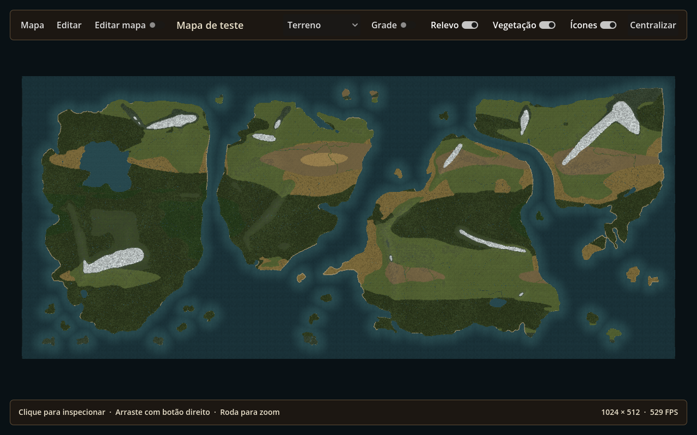
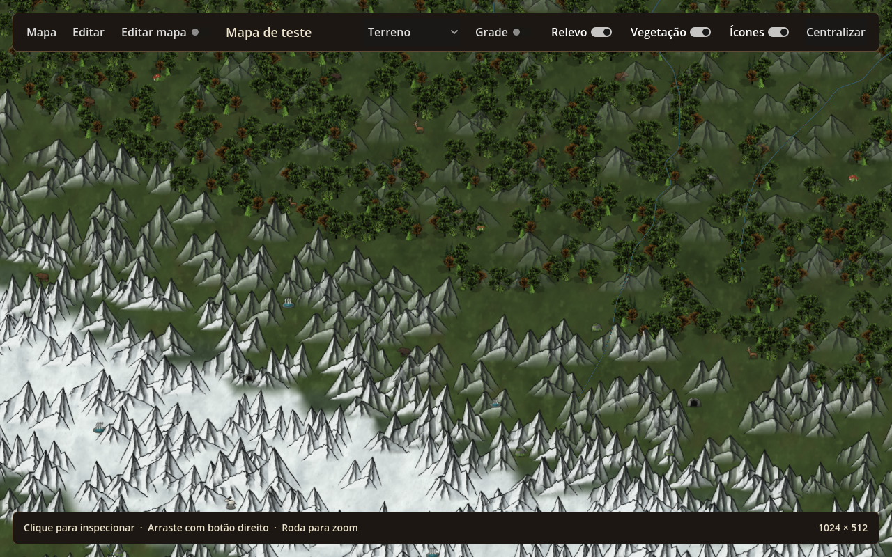
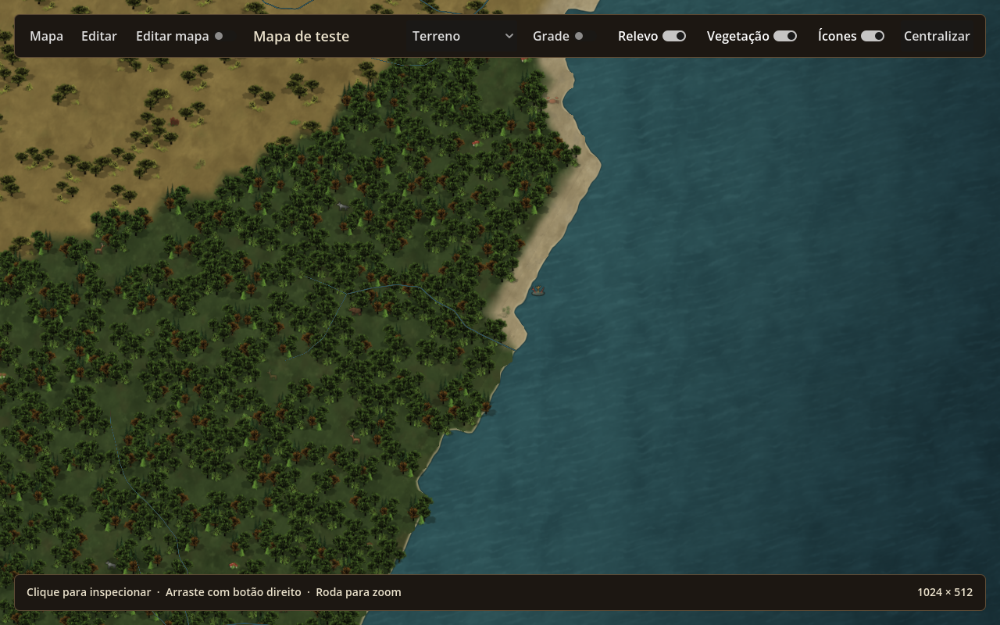

# Conferência visual — Alpha 1.1.30

Conferência realizada em 20/11/2026, a partir do walkthrough visual preparado pelo Argon e das artes presentes no workspace. As capturas abaixo foram refeitas no aplicativo durante o benchmark 1024×512, gerador v30, seed 1234, quatro continentes e 50% de terra.

## Visão geral

## Relevo, floresta e ícones

Conferidos o volume das montanhas, os cumes nevados, a mescla das encostas com o bioma, a sobreposição de vegetação e os ícones com fundo transparente. A distribuição e as variantes usam hashes determinísticos.

## Costa

Conferidas margens, água rasa/profunda e convivência entre a costa suavizada e a decoração próxima da água.

## Recursos e integração

O carregador e o shader concordam em três variantes por arte. São usadas 159 imagens: 14 tipos de terreno/água, 5 de relevo, 6 de vegetação e 28 ícones, cada um em três variantes. Os recursos vegetais incorporam elementos do Yughues Isometric Plants; consulte os [créditos](../THIRD_PARTY_NOTICES.md).

O teste do pacote exige todas as variantes e verifica imagens não vazias e transparência das sobreposições, evitando depender do fallback de uma variante ausente. O EXE é testado fora da pasta do projeto para conferir a leitura dos recursos empacotados.

## Desempenho indicativo

Uma execução local no Godot 4.7.2 .NET, OpenGL Compatibility, RTX 5070, sem VSync: aproximadamente 1.202 FPS médios em pan/zoom; pior troca de camada 12,91 ms; p95 de edição 2,4 ms. Os números se referem a este computador e enquadramento, não são mínimos garantidos nem uma nova matriz de desempenho em todos os tamanhos.

As alterações do gerador v30 já foram validadas separadamente. Esta conferência se concentra nas artes, no carregamento e no pacote de distribuição.

O EXE Release também foi conferido numa pasta isolada: as 159 texturas passaram na validação, o smoke completo terminou com sucesso e as capturas confirmaram a aparência do pacote. O benchmark desse EXE mediu aproximadamente 1.272 FPS em pan/zoom, troca de camada mais lenta de 11,03 ms e p95 de edição de 2,3 ms; novamente, são medidas locais de uma execução.
