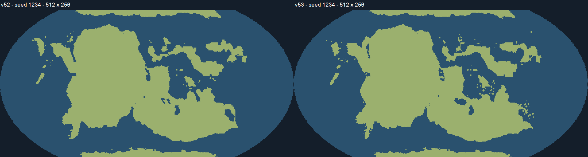
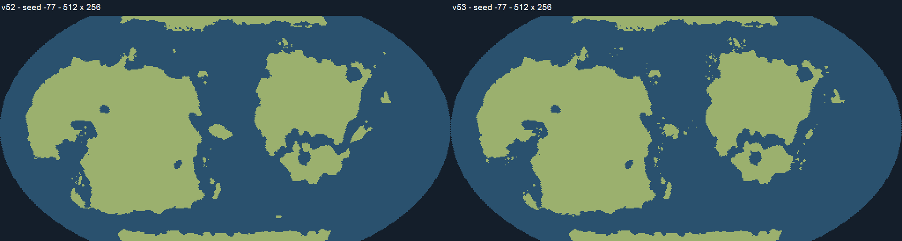
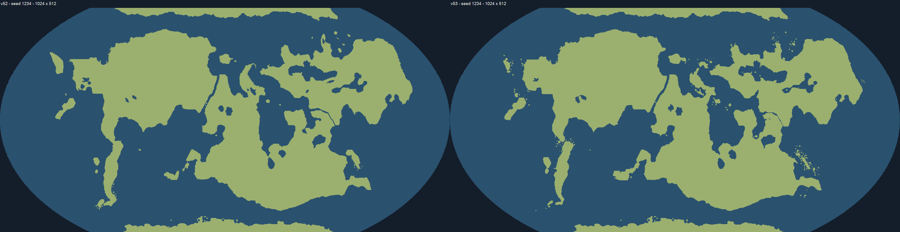
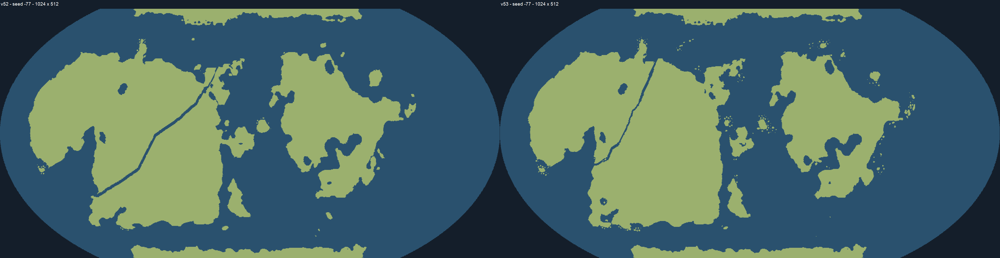

# Arquipélagos no atlas — gerador v53

## Por que os continentes parecem separados por cortes

As placas continentais principais são escolhidas por seed e podem ser vizinhas. Sua influência forma uma superfície contínua, que pode emergir como uma massa única. `SeparatePlateContinents`, executado depois de selecionar a terra, tenta atingir o número solicitado de continentes: escolhe núcleos na massa unida, divide sua ocupação e transforma as fronteiras em canais. A largura básica é `height / 192`, com mínimo de um hex e variação espacial.

Assim, garantir componentes terrestres separados não garante continentes afastados por oceanos amplos. O resultado pode ser uma grande massa dividida por corredores estreitos, como na imagem fornecida. Essa separação artificial também não penaliza explicitamente colisões tectônicas fortes. O problema é da geração física, não dos nomes ou cores da camada Regiões.

A v53 desta rodada altera a formação das ilhas do atlas. A distribuição dos núcleos continentais e a rotina de canais permanecem como antes; a correção estrutural desse padrão continental continua pendente.

## Mudança dos arquipélagos

Os arcos convergentes do atlas tinham largura e pulsos que aumentavam com a resolução do mapa. Isso ampliava as construções vulcânicas junto com o mundo, favorecendo massas grandes. Muitas microplacas continentais também sustentavam plataformas insulares largas.

Na v53, apenas no atlas:

- A maioria das microplacas continentais tem influência menor; uma parte mantém plataformas largas e ilhas principais grandes. As placas principais e a quantidade de placas são preservadas.
- Os arcos de subducção passam a ter largura limitada em hexes. Colisões entre duas placas continentais mantêm suas cordilheiras.
- Núcleos vulcânicos compactos, espaçados e determinados pela seed formam ilhas menores. Alguns setores continuam sustentando ilhas principais maiores.
- O orçamento adicional de ilhas pequenas passa de 0,3% para 0,6% da terra, limitado a 512 hexes. O limite de grupos acompanha o tamanho do atlas, até 128. O acréscimo continua condicionado à compensação continental local segura, limitada a 1% por massa.

As novas formas nascem nos campos tectônicos, antes da seleção da terra. Não existe uma etapa de apagar ilhas prontas para reconstruí-las como fragmentos. A etapa posterior só acrescenta ilhas e preserva as ilhas já formadas. A quota terrestre continua exata.

## Comparação de tamanhos

Mesmas seeds e parâmetros, v52 → v53, excluindo terra polar. A coluna ≥64 é uma faixa de diagnóstico de ilhas; não equivale a uma categoria geográfica nova. As ilhas de 10–63 hexes e as ilhas grandes continuam presentes.

| Dimensões | Seed | Wrap | Ilhas de 3–9 | Ilhotas de 1 | Ilhas ≥64 | Área das ilhas ≥64 |
| --- | --- | --- | --- | --- | --- | --- |
| 512×256 | 1234 | Não | 18 → 45 | 10 → 26 | 7 → 4 | 4106 → 1676 |
| 512×256 | 1234 | Sim | 17 → 38 | 11 → 30 | 6 → 6 | 1256 → 1107 |
| 512×256 | 1 | Não | 20 → 43 | 7 → 26 | 1 → 1 | 104 → 68 |
| 512×256 | 1 | Sim | 19 → 44 | 12 → 30 | 9 → 8 | 1670 → 1545 |
| 512×256 | −77 | Não | 20 → 39 | 8 → 39 | 4 → 4 | 693 → 513 |
| 512×256 | −77 | Sim | 18 → 41 | 6 → 22 | 1 → 1 | 298 → 89 |
| 1024×512 | 1234 | Não | 17 → 102 | 8 → 49 | 7 → 9 | 3527 → 5801 |
| 1024×512 | −77 | Não | 20 → 90 | 6 → 50 | 11 → 8 | 4187 → 4542 |

A amostra completa inclui ainda seis cenários em 128×64: 178 → 472 ilhas de 3–9 hexes, 49 → 42 ilhas ≥64 e área total dessas ilhas de 16115 → 15408 hexes. Os resultados variam por seed: reduzir o tamanho de uma fonte tectônica altera o nível do mar que mantém a quota global e também pode separar uma península, formando outra ilha principal. A área total das ilhas grandes não diminui em todo mapa; os testes não escondem os dois casos de aumento em 1024×512.

## Verificação visual

Máscaras de diagnóstico das mesmas seeds: v52 à esquerda, v53 à direita. Não são capturas da arte final no Godot.









Para reproduzir:

```powershell
dotnet run --project tests/GeneratorChecks -- --atlas-islands-only --island-review
./tests/GeneratorChecks/Review-Islands.ps1 -ReviewDirectory .godot/island-review53 -Versions 52,53 -Heights 64,256,512
```

## Testes

O build do projeto Godot/.NET passou com zero erros e zero avisos. A suíte completa `GeneratorChecks` terminou com código 0 e `All generator checks passed.`. Os 14 cenários de comparação incluem três seeds, wrap ligado/desligado e mapas de 128×64, 512×256 e 1024×512.

Além das contagens, os testes verificam quota exata, determinismo, partição das regiões e compatibilidade dos mapas Região com a v52. Fixtures da etapa aditiva confirmam que ilhas originais de 6 e 64 hexes mantêm todos os seus hexes, a massa principal permanece conectada e as novas ilhas respeitam tamanhos e orçamento. Os testes de preservação da v52 continuam fixados na receita v52, incluindo a rejeição da fragmentação v51 como controle negativo. A suíte também cobre geleiras/vulcões, clima existente, relevo, tectônica, arquivos, locks e regeneração regional.

## Compatibilidade e limites

A mudança é específica de novas gerações de atlas v53. Mapas Região preservam a receita da v52. Saves existentes mantêm sua geografia e sua versão; a regeneração regional respeita essa versão. Não há reconstrução automática de mapas editados.

O classificador de oceanos, mares e arquipélagos continua na versão 2. O agrupamento nominal não cria ilhas nem une terra. A atualização climática permanece pendente, assim como a revisão estrutural dos canais continentais.

Não foi feita publicação nem alteração da versão Alpha 1.1.32. v53 é a versão interna do gerador nesta árvore de desenvolvimento.
