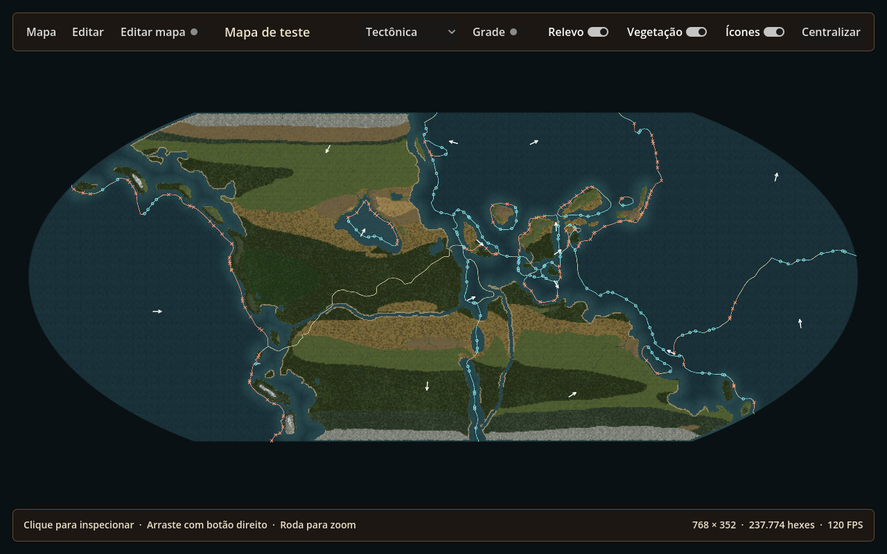
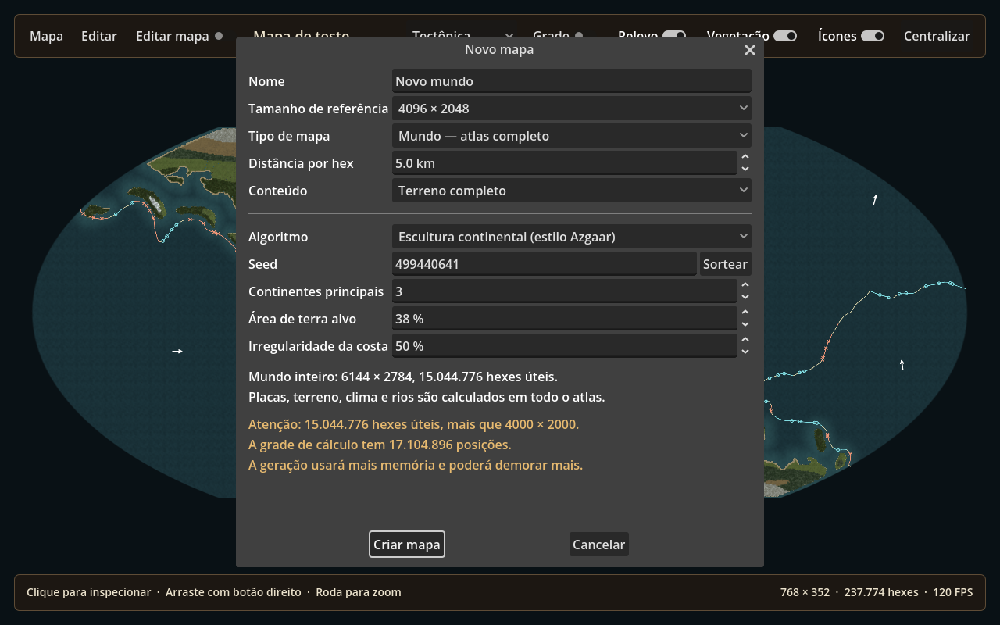

# Geração integral do atlas — v37

## Comportamento

**Mundo — atlas completo** agora gera a área inteira do atlas com topo e base retos e laterais curvas. Não há mais um retângulo de terreno no centro, linhas copiadas de polos ou terra desenhada fora dos dados. Todos os hexes úteis são reais, selecionáveis, editáveis, salvos e regeneráveis.

**Região — recorte aberto** continua sendo um retângulo nas dimensões escolhidas. As receitas antigas permanecem disponíveis para os arquivos salvos com versões anteriores.

O tamanho selecionado funciona como referência no modo Mundo. A área de cálculo é ampliada em 1,5 vezes na largura e 1,35 na altura, com arredondamento para chunks. O maior preset de referência, 4096 × 2048, resulta em:

- Grade de armazenamento/cálculo: **6144 × 2784**, ou **17.104.896 posições**.
- Área útil do atlas: **15.044.776 hexes reais**.
- Os cantos fora do contorno não são terra, não recebem biomas terrestres, não podem ser editados e não entram na porcentagem.

O formulário mostra esses valores antes da criação e um aviso destacado quando ultrapassa 8.000.000 hexes úteis (referência de 4000 × 2000). O aviso informa o uso maior de memória e tempo; não cria uma etapa adicional de confirmação.

## Geração

O mesmo domínio define a posição das placas e o recorte de seus contatos, o terreno, a costa, o relevo, os biomas e as rotas fluviais. O nível do mar e a reposição de terra após a separação continental respeitam a quantidade útil de hexes. Uma pequena faixa oceânica real fecha a costa junto ao contorno, sem reservar a larga moldura interna das versões anteriores.

O renderer exibe os dados desse domínio diretamente. O código de continuação decorativa é mantido apenas para mapas antigos. A máscara e os limites de edição são reconstruídos deterministicamente do manifesto, preservando salvar/abrir, seleção, pincéis e locks.

`ReferenceWidth` e `ReferenceHeight` registram o tamanho de referência para que o formulário possa restaurá-lo sem ampliar duas vezes um mapa existente. Mundo v37 não utiliza `PolarOceanRows`.

## Verificação

- Build sem erros ou avisos.
- 36 combinações específicas do atlas: três seeds, 3/12 continentes, com/sem wrap e 10/38/65% de terra. Área exata, massas principais separadas, placas e rios dentro do domínio.
- Clima calculado também na área ampliada, além do antigo retângulo de referência.
- Determinismo, regeneração na borda curva, salvar/abrir e domínio preservado.
- Regressões dos modos anteriores, faixas polares da v36, 72 casos de separação continental, locks e hidrologia.
- Formulário: ampliação integral, restauração das referências e aviso no maior tamanho.
- Revisão no renderer real: terreno real em todo o atlas, cantos fora do domínio não selecionáveis e ausência da moldura decorativa.
- Teste geral direcionado à v37 passou.
- Teste máximo: **15.044.776 hexes úteis**, **5.717.014 de terra** para o alvo de 38%, **23.865 rios**, nenhum término fluvial sem destino; **86,51 s nesta máquina**.

Reproduzir: `dotnet run --project tests/GeneratorChecks/GeneratorChecks.csproj`; Godot com `--smoke-test --current-generator-only`, `--maximum-generation --world-map` e `--ocean-frame-review` (renderer gráfico).
