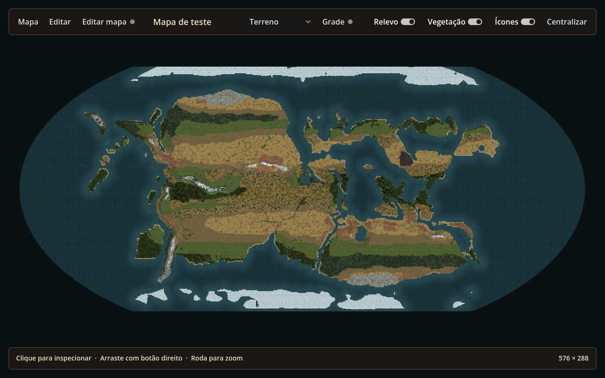
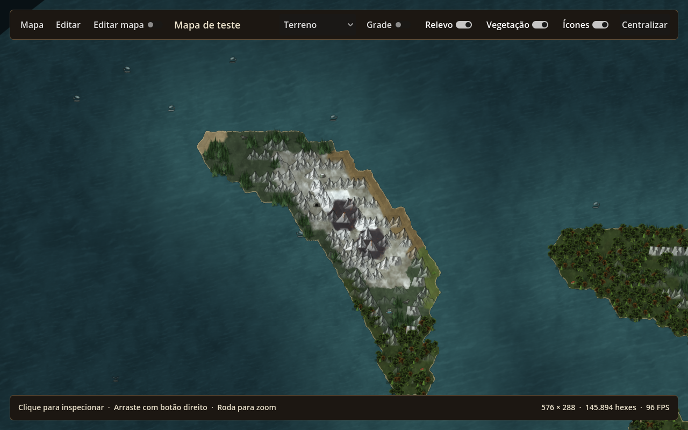
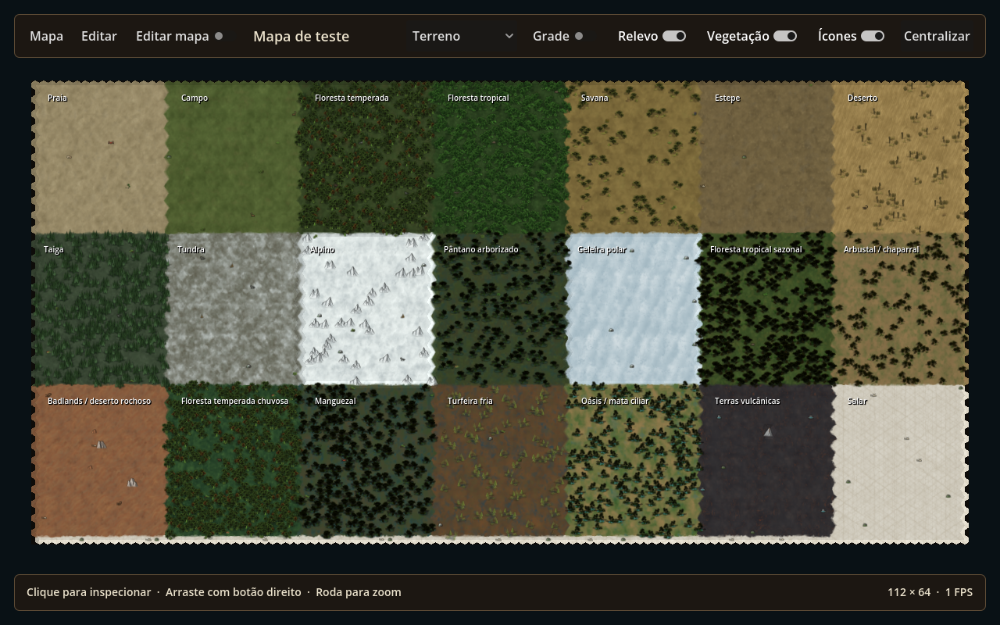

# Biomas, geleiras polares e vulcões insulares — v46

A proposta revisada foi integrada: 21 biomas terrestres, quatro conjuntos de água, vegetação, relevos especiais e ícones. A distribuição usa os três arquivos de cada conjunto. Oceano raso/profundo agora também mistura as três variantes, com pesos espaciais contínuos.

## Alpino e polos

- Alpino exige frio e começa numa transição irregular entre 3.800 e 4.000 m; acima de 4.000 m o limiar de altitude sempre é atendido. A condição térmica é média anual até 3,5 °C. As alturas de 2.300 m deixam de determinar alpino na receita nova.
- Geleira automática é exclusiva das placas polares do Mundo. O restante do mundo frio usa tundra, alpino e artes nevadas, sem receber o bioma de geleira.
- Cada seed combina massas de gelo ligadas às bordas retas com arquipélagos, canais e costas recortadas. As margens oceânicas laterais continuam sem terra.
- O gelo é terreno real, com água, elevação, relevo, clima e bioma; não é uma moldura decorativa. As placas polares continuam extras e oceânicas, com essa exceção de superfície congelada.
- Toda a faixa polar fica fora da cota de terra/mar, inclusive os hexes ocupados pelo gelo. `MapDomain.CountsTowardLandQuota` permite contar o numerador e o denominador com a mesma regra.

## Ilhas vulcânicas

A busca usa componentes terrestres ligados ao oceano, exclui terras polares, massas grandes e recortes que chegam à borda de uma Região. Os centros precisam ultrapassar 2.000 m e ser máximos locais no interior da ilha, com afastamento da praia. Centros distintos podem coexistir na mesma ilha, com espaçamento e quantidade proporcionais ao tamanho.

O centro recebe `GeographicFeatures.Volcano`, a arte de vulcão e seus detalhes. Um avental irregular recebe o bioma vulcânico ao redor; a ilha não é inteiramente convertida. A geometria usa as elevações existentes, sem criar um pico artificial para forçar vulcões em toda seed.

Regenerar somente características lê a água e a elevação atuais, inclusive edições, e respeita seus locks. A classificação do terreno e os vulcões são campos independentes. A interface de regeneração oferece **Características geográficas**.

## Regras dos biomas

Temperaturas em média anual; chuva em mm/ano. As condições mais específicas têm prioridade.

| Bioma | Regra principal |
|---|---|
| Geleira | Terra gerada exclusivamente nas placas polares |
| Alpino | 3.800–4.000 m por campo regional, frio até 3,5 °C |
| Tundra | Até −5,5 °C, fora do alpino e do gelo polar |
| Taiga | Até 4,5 °C, chuva a partir de 400, cobertura florestal permitida |
| Deserto | Chuva abaixo de 260, depois das regras frias |
| Shrubland | 12–22,5 °C, chuva 360–680 e tendência regional seca |
| Estepe | Chuva abaixo de 480, depois do shrubland |
| Floresta tropical úmida | A partir de 22,5 °C e 1.550 mm |
| Floresta temperada chuvosa | 4,5–22,5 °C e pelo menos 1.850 mm |
| Floresta tropical sazonal | A partir de 20 °C e 1.050 mm, fora das anteriores |
| Savana | A partir de 20 °C, umidade insuficiente para floresta; acima da faixa de estepe |
| Floresta temperada | Acima de 4,5 °C e pelo menos 1.000 mm, fora das florestas anteriores |
| Campo | Cobertura restante |
| Praia | Mantida a detecção existente de costa baixa e sedimentar |
| Manguezal | Costa abrigada/foz, até 30 m, pelo menos 19,5 °C, chuva ou aporte fluvial |
| Swamp | Baixada quente, plana e úmida, com água disponível; regra v44 preservada |
| Bog | Baixada plana até 260 m, −5,5 a 5,5 °C, água doce e chuva a partir de 850 |
| Oásis | Deserto/badlands com aporte de água doce e temperatura acima de 4,5 °C |
| Badlands | Menos de 350 mm, terreno seco com quedas em várias direções e manchas de erosão |
| Salar | Depressão local fechada e plana, seca, sem aporte de água doce, acima de 4,5 °C |
| Vulcânico | Centros insulares elegíveis e seus aventais |

Sazonalidade, erosão e acúmulo de sais são aproximações contextuais; não há simulação mensal do tempo ou transporte de sedimentos/salinidade. Esses critérios evitam preencher esses biomas somente por sorteio, sem prometer um modelo físico completo.

## Artes e edição

- 25 conjuntos de chão, 11 de vegetação, nove de relevo e 33 ícones: **234 imagens verificadas**, em três variantes.
- Palmeiras de oásis, manguezais, árvores sazonais, arbustos e vegetação de turfeira integrados ao catálogo e à distribuição por habitat.
- Vulcões, cânions e rochas de badlands usam sobreposições próprias. Escarpas continuam associadas às bordas dos planaltos. Os novos detalhes também participam da seleção de ícones.
- A paleta de pintura e a inspeção exibem os 21 biomas em português. Os IDs anteriores foram preservados; os dez adicionais foram anexados ao enum após swamp.
- Água, formas geográficas, características, biomas e artes permanecem independentes. Neve não precisa transformar uma montanha fora dos polos em geleira.

## Verificação

- Build sem erros ou avisos; suíte completa do gerador aprovada.
- Testes da transição alpina, florestas, manguezal abrigado, bog, oásis, salares fechados e badlands.
- Fixture com dois vulcões na mesma ilha, aventais, exclusão de água/continente, regeneração sobre geometria editada e lock de características.
- Polos nas três seeds 1234, 1 e −77, com e sem wrap: geleiras nos dois hemisférios, nenhuma fora dos polos, cota não polar exata, regeneração e save/load.
- Matriz de cotas de 10/38/65% conserva o alvo fora dos polos. Exemplo de 38%: 5.381 hexes terrestres em 14.162 não polares, mais 802 hexes de gelo fora da conta.
- Smoke nativo de 524.288 hexes, formato GPU, corredor dos rios e editor com 24 operações de regeneração aprovados.
- Revisão gráfica de três mundos: 7.006, 8.440 e 7.123 hexes de geleira; respectivamente 3, 0 e 6 centros vulcânicos, sem forçar um vulcão em ilhas inadequadas.

Comandos: `dotnet run --project tests/GeneratorChecks/GeneratorChecks.csproj --no-restore` (ou `-- --expanded-only` para as regras novas). No Godot: `--expanded-biomes-review`, `--verify-map-format`, `--validate-editor-current`, `--river-clearance-review` e `--smoke-test --current-generator-only`.

Para gerar a nova geografia e classificação, criar um mapa v46. Saves antigos conservam seus dados e sua receita; abrir não adiciona gelo ou vulcões retroativamente.
