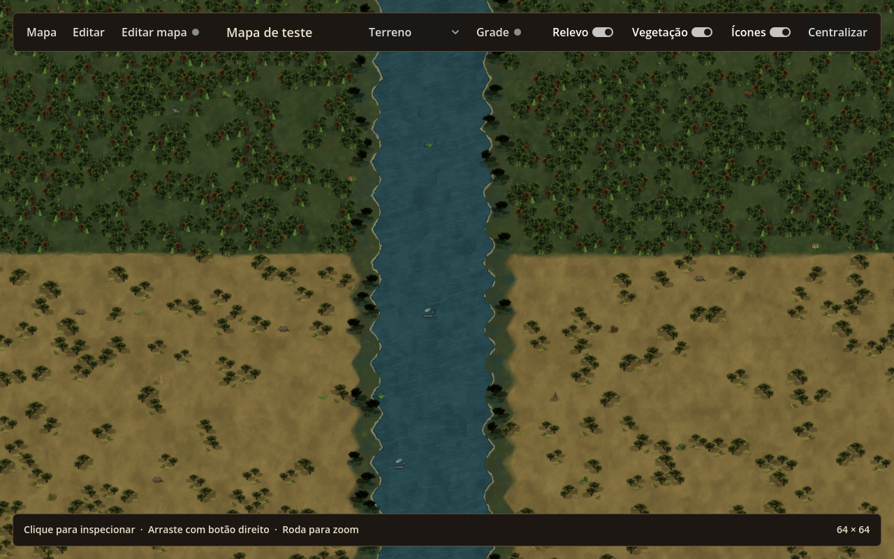
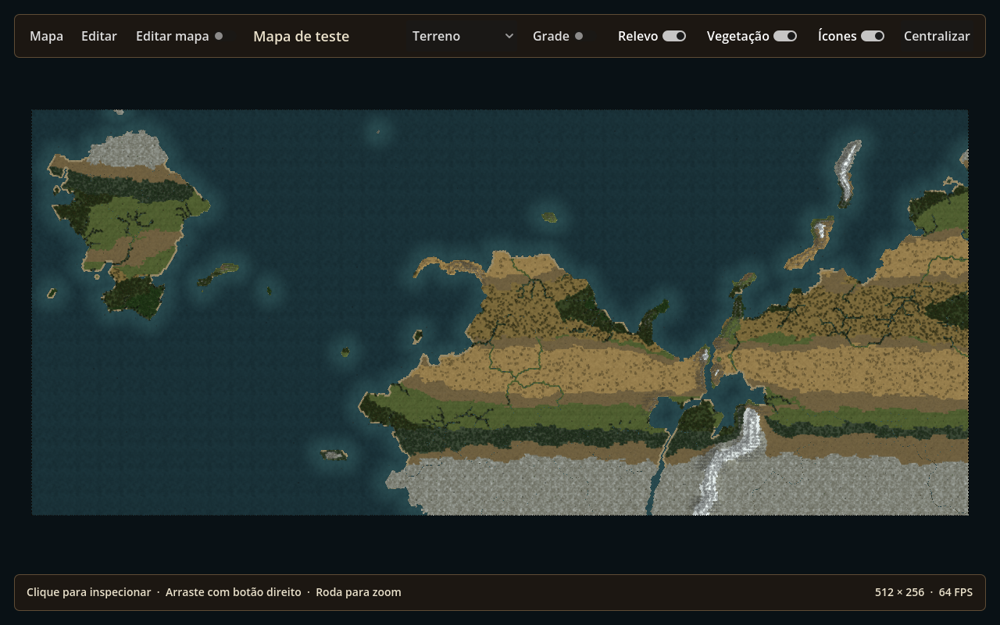

# Bordas irregulares e pântanos — v44

## Origem das baías e lagos compridos

A geração tectônica atual não usa o antigo carimbo de baías da receita legada. Depressões gaussianas ao longo de contatos divergentes podem atravessar grandes extensões; o corte por nível do mar forma lagos quando a depressão é fechada e enseadas quando está conectada ao mar. Os canais de separação de continentes também podem criar corredores alongados. Sem o save e a seed dos prints, não se atribui cada corpo d'água especificamente a um desses mecanismos.

Esses corpos não são removidos indiscriminadamente: riftes e corredores oceânicos podem continuar longos. A v44 varia o eixo, a largura e a intensidade das depressões por ruído espacial, reduzindo sua uniformidade tubular. Essa alteração participa da seleção global de água, que continua ajustando a porcentagem de terra. As versões anteriores preservam sua receita.

## Ruído nas bordas

- Não há SVG nesse blend: `Terrain.gdshader` combina amostras vizinhas e curvas quadráticas. A mistura arredondada de biomas foi reduzida de 0,36 para 0,12; a faixa difusa foi estreitada.
- Um campo deformado de ruído em três escalas perturba costas, lagos e transições entre biomas. Detalhes finos são atenuados quando não cabem nos pixels, reduzindo cintilação ao afastar o zoom. A fase depende da seed e mantém o wrap horizontal.
- Terreno, rios e máscara de recorte compartilham `BoundaryNoise.gdshaderinc`, com o mesmo deslocamento costeiro, para não separar a foz da costa ou a vegetação do leito.
- Além do shader, os biomas novos recebem um passe espacial de deslocamento das bordas nos dados. O raio acompanha a resolução; o passe preserva água, praias, locks e a adequação climática do bioma de destino. A consolidação de biomas pequenos roda depois. A margem de regeneração inclui o alcance adicional.

## Pântano arborizado

`BiomeType.Swamp` foi acrescentado como ID 11, preservando os IDs anteriores. Usa as três variantes de `tiles/swamp` e `vegetation/swamp_trees`, com detalhes de vegetação úmida. Também está disponível no editor e na inspeção.

O pântano é aplicado depois da hidrologia, em terra a até 260 m, plana ou suavemente ondulada, acima de 5,5 °C, sem degraus locais maiores que 120 m. Exige chuva e disponibilidade hídrica: rio, margem de lago raso ou enseada rasa abrigada. Ruído espacial deixa a faixa descontínua. Margens frias, áridas, altas ou íngremes são excluídas; água profunda não vira pântano pelo formato do lago.

Essa classificação não muda o tipo de água ou a altitude, portanto não consome terra/mar nem fecha passagens. A água central dos lagos continua sendo água. Na região de teste 512 × 256, seed 1234, apareceram 1.134 hexes de pântano; os 49.807 hexes terrestres e o máximo de 6.164 m respeitam as configurações.

## Revisão visual

Fixture com lago, transição de biomas e pântanos nas margens:

Região gerada com a v44:

## Verificação

Build sem erros ou avisos; fixtures de pântano com/sem wrap, frio, aridez, altitude, locks e conservação de água/elevação. Fixture de borda de bioma confirma deslocamento dos dados e respeito ao lock. Revisão nativa dos materiais e árvores, teste de recorte dos rios e smoke de 524.288 hexes aprovados. A suíte completa verifica cotas, continentes, atlas, polos, clima, cumes, regeneração, determinismo e save/load.

Comandos: `dotnet run --project tests/GeneratorChecks/GeneratorChecks.csproj --no-restore`; opção `-- --swamp-only` para as fixtures novas. No Godot: `--boundary-review`, `--river-clearance-review`, `--smoke-test --current-generator-only`.

O ruído visual aparece ao reabrir mapas existentes. A nova receita de riftes, o passe dos biomas e a geração automática de swamp exigem mapas novos v44. Arquivos antigos não são regenerados ao abrir.
