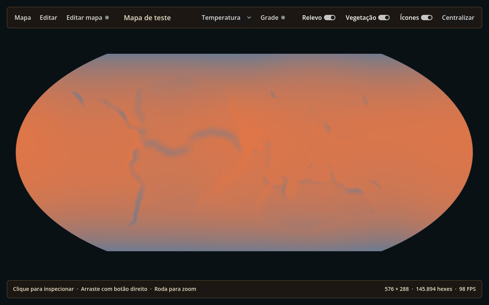
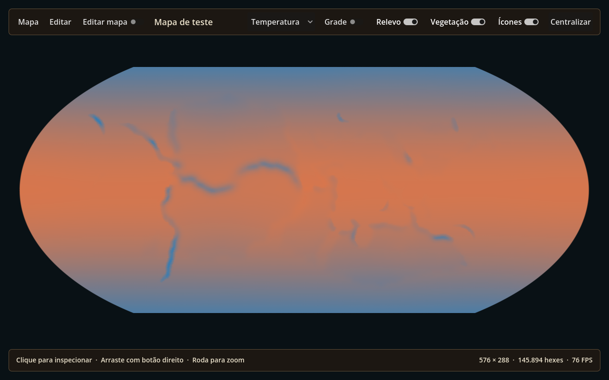
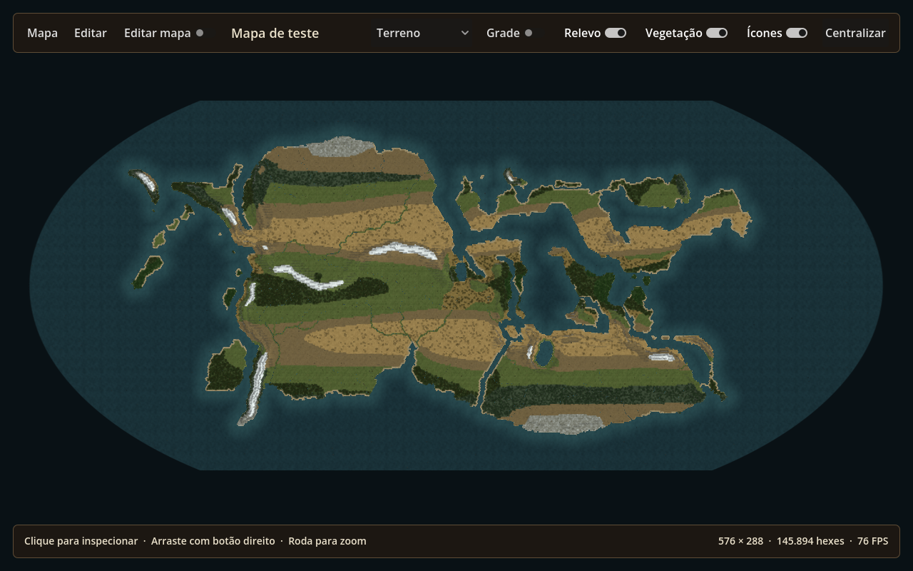

# Clima e altitude — gerador v43

## Diagnóstico

A especificação `Especificacao_Clima_Temperatura_Chuva_Estilo_Azgaar.md` ainda não tinha sido aplicada ao clima: persistiam a curva térmica antiga, a moderação marítima em direção a +12 °C e uma chuva base sem vale subtropical seco. O transporte de umidade também repunha muita água no interior e retirava pouca ao cruzar serras. Isso mantinha grandes áreas quentes úmidas demais para deserto.

30 °C não determina deserto por si só. A classificação já distinguia corretamente calor seco de calor úmido; a correção foi feita no clima que a alimenta, preservando a floresta tropical onde há calor e muita chuva.

Não havia teto de altitude em 2.300–2.400 m. A conversão anterior somava até `4100 * colisão^1,25` à base baixa e depois suavizava o campo. Muitas seeds e resoluções não aproveitavam a faixa superior dessa curva. Nas amostras desta verificação, os máximos antigos variaram de 3.330 a 4.144 m.

## Temperatura e precipitação

- Fórmula térmica do documento: `265 − 545 × (0,65 × lat² + 0,35 × lat^1,55)`, em décimos de grau. Ao nível do mar e antes da moderação/ruído: equador 26,5 °C; 22,5°: 22,1 °C; 45°: 11,1 °C; 67,5°: −5,6 °C; polos −28 °C. Alguns valores tabelados no documento diferem da sua fórmula; aqui são registrados os resultados calculados da fórmula.
- Oceano modera a temperatura em direção a um alvo dependente da latitude, limitado entre −4,5 °C e 24,5 °C; os polos não são atraídos por +12 °C. A mistura é parcial, não força a água polar a ficar acima de zero.
- Ruído regional menor e atenuado pela influência marítima; gradiente vertical preservado de −6,5 °C por 1.000 m. Montanhas muito altas podem ser mais frias que o polo ao nível do mar.
- Chuva base com pico equatorial, vale subtropical centrado em `lat=0,28`, segundo pico temperado em `lat=0,54` e redução polar. As faixas de vento existentes continuam conduzindo o transporte.
- Condensação orográfica com divisor 1.500 m e recuperação terrestre reduzida de 0,55 para 0,35. A precipitação combina `baseline × (0,35 + 0,85 × umidade)` com reforço de barlavento de até 750 mm, e supressão térmica em ar frio, conforme a especificação.

## Cumes mais altos e raros

Após a suavização, a cauda superior das elevações nas cordilheiras ativas é calibrada para um máximo determinístico de 6.000–8.000 m por seed. O peso cresce com a quarta potência da altura relativa: o aumento se concentra nos cumes, sem elevar toda a cadeia pelo mesmo fator.

Terreno até 800 m, áreas sem levantamento tectônico suficiente, água e posições fora do domínio ficam intactos. Um mapa sem cordilheira desenvolvida não recebe um pico artificial para cumprir a faixa. O ajuste não usa cotas de terra nem muda continentes, lagos, profundidades ou faixas oceânicas obrigatórias. A classificação de formas geográficas e o clima leem as alturas finais. A camada Elevação passa a representar até 8.000 m.

## Resultados

Regiões de 512 × 256, 38% de terra, com wrap; cada amostra tem 49.807 hexes terrestres:

| Seed | Máximo v42 | Máximo v43 | Terra ≥ 6.000 m | Desertos v42 → v43 |
|---|---:|---:|---:|---:|
| 1234 | 4.144 m | 6.164 m | 10 (0,020%) | 0 → 7.061 |
| 1 | 3.934 m | 7.664 m | 153 (0,307%) | 14 → 5.390 |
| −77 | 3.478 m | 7.360 m | 9 (0,018%) | 0 → 6.026 |

No atlas nativo de 576 × 288, seed 1234, a altitude máxima passou de 3.330 para 6.164 m. A máscara de água permaneceu idêntica. As contagens diferem das regiões porque o domínio e as placas são diferentes.

Temperatura anterior:

Temperatura nova, mesma seed e enquadramento:

Terreno com o novo clima:

## Validação e compatibilidade

Build sem erros ou avisos; suíte completa do gerador aprovada, incluindo cotas, atlas, polos, separação de continentes, tectônica causal, classificação, formato, determinismo, regeneração e save/load. Testes específicos verificam temperaturas por latitude, gradiente vertical, cinturões secos, sombra de chuva, contraste calor seco/úmido, raridade dos cumes e conservação das terras baixas/profundidades. Revisão nativa de Região/Mundo e smoke de 524.288 hexes também aprovados.

Comandos: `dotnet run --project tests/GeneratorChecks/GeneratorChecks.csproj --no-restore`; opção `-- --climate-height-only` para as fixtures novas. No Godot: `--climate-height-review` e `--smoke-test --current-generator-only`.

A receita nova é v43. Mapas existentes preservam sua versão, inclusive ao regenerar com a receita salva; abrir não modifica o mundo. Para testar a nova geração, criar um mapa novo.
