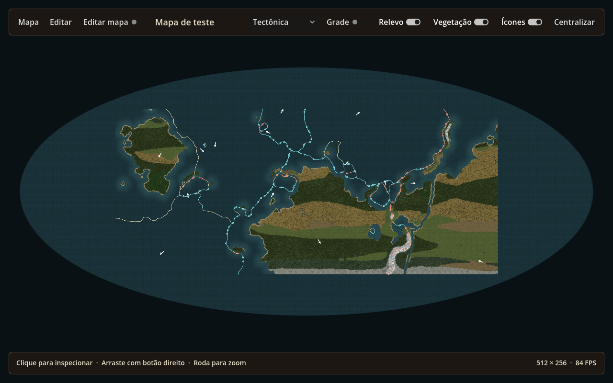
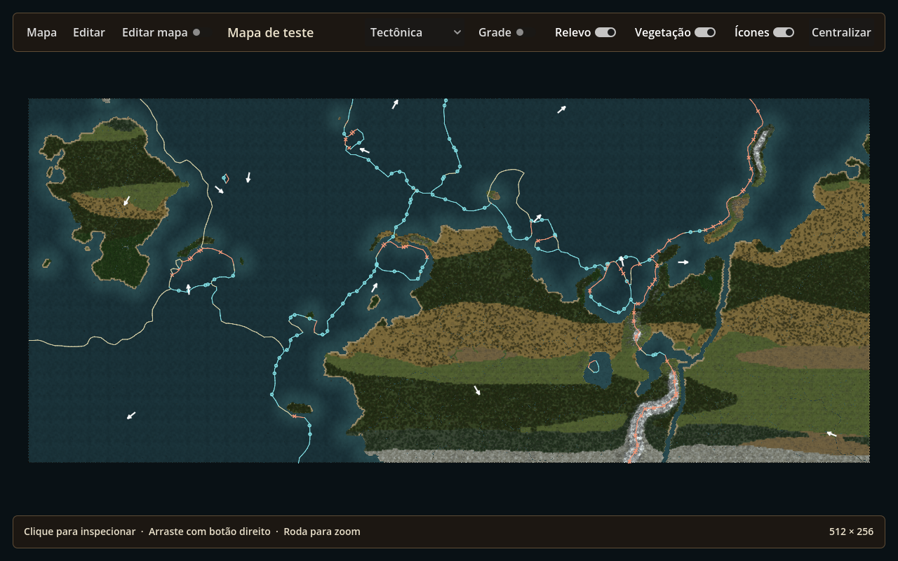

# Continentes separados e oceano decorativo externo — v35

## Diagnóstico

Na v34, o alvo de terra era calculado corretamente sobre todos os hexes do retângulo, incluindo a reserva oceânica elíptica. Essa reserva baixava o campo periférico antes da escolha do nível do mar e redistribuía terra para o interior. O parâmetro de continentes definia placas continentais, mas não garantia que suas terras ficassem separadas.

## Mudança

- A partir da v35, Mundo e Região geram os mesmos hexes para a mesma seed e os mesmos parâmetros. A elipse não participa da geração.
- Mundo desenha oceano texturizado fora do retângulo, contido em uma elipse visual. Essa área não tem hexes, não é selecionável ou pintável e não entra em porcentagens, tectônica, clima, rios, salvamento de terreno ou regeneração. O enquadramento inicial considera a moldura no zoom.
- O alvo continua sendo `floor(largura × altura × percentual / 100)`, apenas no retângulo gerado.
- Se faltam massas principais separadas, núcleos são distribuídos nas massas grandes existentes. Uma propagação com custo baseado no terreno encontra divisões, e canais dão continuidade à separação por água. O alcance dos canais aumenta com o tamanho do mapa.
- A terra removida é reposta nas costas com melhor pontuação geológica. Cada avanço é revalidado para não reconstruir pontes entre continentes. Não há cota igual de área por continente.
- O controle de continentes indica uma quantidade mínima de massas principais; ilhas menores e outras massas naturais podem surgir além desse número.

A receita da v34 continua disponível para os arquivos salvos com essa versão, inclusive sua borda oceânica interna. A mudança de geração vale para mapas novos na v35.

## Verificação

- Build sem erros ou avisos.
- 72 combinações de três seeds, com e sem wrap, 2/3/6/12 continentes e 10/38/65% de terra: massas principais separadas e quantidade exata de terra no retângulo.
- 2048 × 1024, 12 continentes e 65% de terra: 12 massas principais separadas e exatamente 1.363.148 hexes de terra; geração e contagem em 11,71 s.
- Mundo/Região com dados de água, elevação, biomas e arestas fluviais idênticos: a moldura tem zero hexes.
- Regressão das versões anteriores, salvar/abrir, regeneração regional, locks, tectônica, arcos de ilhas e suavização costeira.
- Revisão no renderer real do Godot: oceano texturizado externo, enquadramento da elipse e ausência de seleção na área decorativa.

Comandos: `dotnet run --project tests/GeneratorChecks/GeneratorChecks.csproj -- --separation-large`; Godot com `--smoke-test --current-generator-only`, `--maximum-generation --world-map` e `--ocean-frame-review` (este último com renderização gráfica).

O teste geral direcionado à v35 passou. O teste máximo em 4096 × 2048 passou com exatamente 3.187.671 hexes de terra e nenhum término fluvial sem destino.
