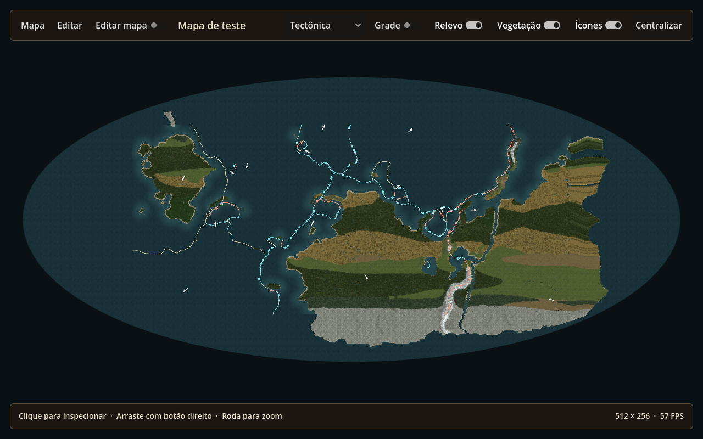

# Continuação visual das costas na moldura — v35

Os cantos retos eram o limite do retângulo de hexes, onde a terra terminava diretamente contra o oceano decorativo. A elipse externa, sozinha, não fechava a costa.

A moldura do modo Mundo agora prolonga visualmente o terreno da borda antes de encerrá-lo no mar:

- A distância ao retângulo arredonda os cantos externos.
- Ruído contínuo pela seed varia o alcance e o deslocamento lateral, formando baías, pontas e reentrâncias.
- A faixa reaproveita o bioma, a elevação e a arte do terreno da borda; a elevação visual cai em direção à costa.
- As transições usam a mesma mistura costeira do mapa, com plataforma rasa perto da nova costa e oceano profundo depois.
- O alcance respeita a elipse, deixando mar entre a costa decorativa e o contorno externo.

É acabamento visual derivado da borda, sem criar hexes, clima ou hidrologia simulados fora da área gerada. Não é selecionável nem pintável e não entra na contagem de terra. Os dados e a receita do gerador v35 não foram alterados. O ajuste aparece nos mapas Mundo v35 já salvos ao reabri-los no projeto atualizado; não é necessário gerar outra seed.

## Verificação

Build sem erros ou avisos e revisão no renderer OpenGL real do Godot: Região preservada sem moldura; Mundo com costa externa irregular e arte contínua; enquadramento da elipse e seleção fora dos hexes verificados. A captura foi inspecionada após estabilização dos frames.

Reproduzir com o Godot gráfico e `--ocean-frame-review`.

