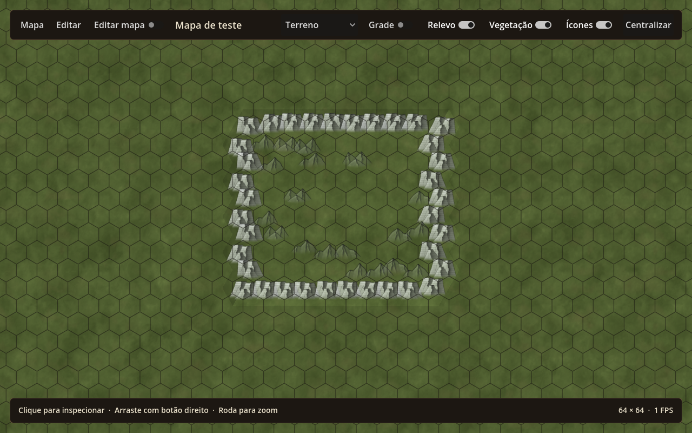
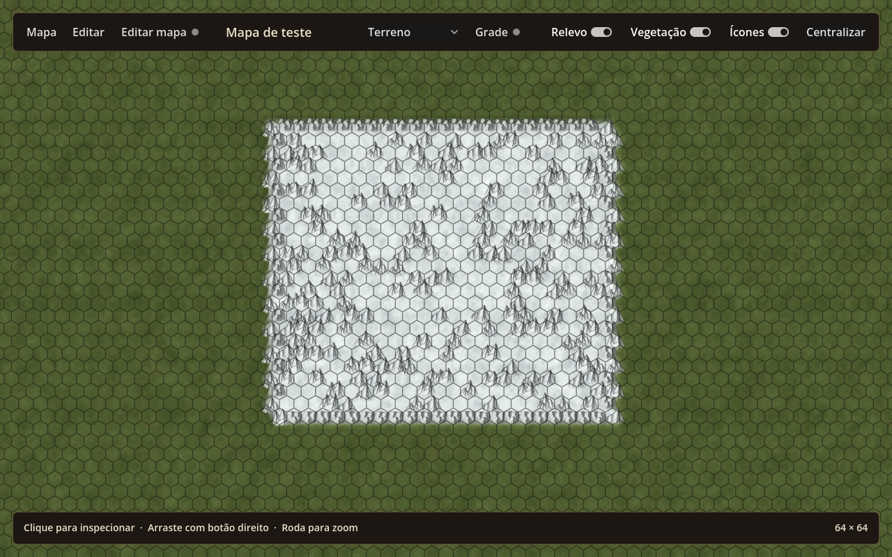

# Símbolos nas bordas das elevações

A distribuição visual de relevo passou a seguir quebras de declividade, em vez de sortear símbolos em toda a área classificada como montanha ou morro.

`ReliefContours` compara a queda imediata e regional, procura a faixa mais forte perpendicular ao contorno e mantém os símbolos ao longo de toda essa faixa. Em uma rampa uniforme, empates favorecem o lado alto, evitando fileiras paralelas ao longo da encosta. Água e posições fora do domínio não entram como terreno baixo: o fundo do oceano não cria um falso paredão.

O renderer recebe a direção da descida. A arte é deslocada em direção à borda e usa leve sobreposição entre hexes, com pouca variação de posição, para não invadir extensamente o interior do planalto. `LandformType.Escarpment` usa as três variantes de `relief/escarpment`, em vez do maciço de montanhas.

Altitude, classificação geográfica, clima, água, quota de terra e features salvas permanecem iguais. A mudança é de apresentação e vale também ao abrir mapas antigos. Os sprites se sobrepõem ao longo do contorno para formar uma faixa visual mais contínua.

Após o ajuste de composição, as bordas também têm ramificações curtas de 2–4 hexes, orientadas para terreno de altura igual ou maior. Âncoras determinísticas variam o alcance dessas ramificações. O interior de terras a partir de 2.800 m (ou 2.300 m no bioma alpino) recebe grupos esparsos: a densidade cresce com a altura e varia com ruído espacial e seed. Planaltos baixos mantêm o centro livre. Assim, o relevo combina contorno, prolongamentos laterais e grupos centrais, em vez de ficar restrito a uma linha.

A arte interior é escolhida sem alterar o relevo salvo: um topo pode continuar classificado como plano e ainda ter montanhas na composição cartográfica. Regiões interiores frias a partir de 3.200 m usam arte nevada.

## Revisão visual

Planalto de 100 hexes a 1.200 m, cercado por terreno a 100 m: interior livre e escarpas somente no lado alto das bordas.

Terra alta de 5.000 m com grupos no interior e ramificações para dentro:

## Verificação

- `dotnet build Mapmaker.csproj --no-restore`: sem erros ou avisos.
- Fixtures de contorno em 128 × 64 e 1024 × 512, com e sem wrap: símbolos no lado alto das bordas, direção de descida correta, planaltos/planícies livres, rampas uniformes sem preenchimento, determinismo e altitude intacta. Contornos abruptos continuam estreitos em resoluções maiores.
- `--terrain-classification-review`: renderer e editor, com pincel, classificação dos vizinhos, locks, undo/redo e cancelamento.
- Composição revisada: ramificações para o lado alto e 61 símbolos em 196 hexes centrais no exemplo de 5.000 m, mantendo o relevo salvo `Flat`. Fixtures com wrap e duas resoluções confirmam contornos, prolongamentos e grupos esparsos no interior. `--verify-map-format` confirma leitura dos IDs e features na GPU após a escolha das artes.
- `--smoke-test --current-generator-only`: 524.288 hexes, save/load, emendas regionais e edição.
- `--river-clearance-review`: recorte de vegetação/ícones alinhado aos rios preservado.

Testes específicos: `dotnet run --project tests/GeneratorChecks/GeneratorChecks.csproj --no-restore -- --contours-only`.
