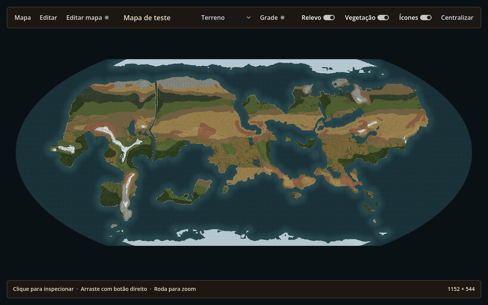
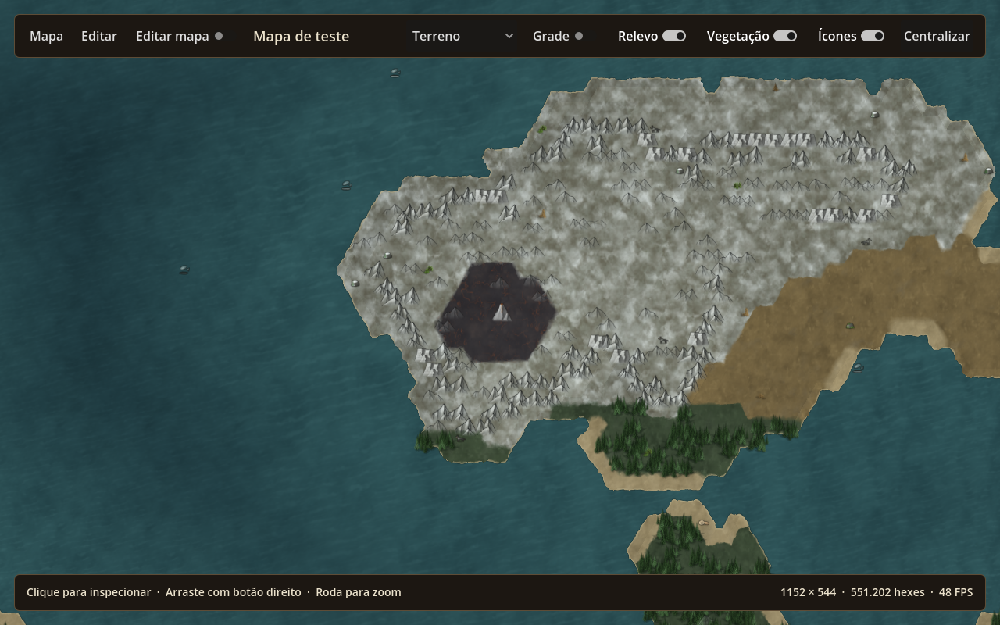

# Formas naturais — gerador v47

## Correções

- **Geleiras:** os dois polos recebem uma base ligada à borda reta do atlas, com costa irregular em três escalas de ruído. Ilhas adicionais podem aparecer à frente da calota. As margens oceânicas laterais continuam reservadas; toda a faixa polar permanece fora da porcentagem de terra e mar.
- **Vulcânico:** substituído o disco de distância hexagonal por crescimento conectado em coordenadas físicas, deformado por ruído em duas escalas e limitado pela altitude e pela costa da ilha. O alcance diminuiu e o conjunto dos aventais fica limitado a 12,5% da área da ilha, com um mínimo de 12 hexes para ilhas pequenas; centros vulcânicos são adicionais. Vários vulcões continuam possíveis, sem espalhar a mancha através da água.
- **Faixas áridas:** a condição de badlands passa a consultar a amplitude regional do relevo, evitando o limiar que alternava entre linhas pares e ímpares. Depois da classificação contextual, uma leitura simultânea dos vizinhos locais e regionais remove manchas estreitas. A leitura inclui uma margem ao redor da seleção para manter a regeneração consistente. Rochas de badlands acompanham o bioma final.
- **Tectônica:** contatos convergentes elevam o terreno, inclusive junto ao eixo de choque oceânico. A antiga escavação do lado subductado foi retirada da nova receita. Contatos transformantes também deixam de escavar; afastamentos continuam abrindo riftes. Arcos de ilhas e cordilheiras continuam presentes.

As correções físicas usam a versão 47. Arquivos anteriores preservam sua receita de geração e seus dados; crie um mapa novo para comparar a mesma seed. A calibração global da porcentagem de terra continua ativa.

## Verificação

- Build do aplicativo: zero avisos e zero erros.
- Suíte completa `GeneratorChecks`: passou, incluindo cotas, separação de continentes, clima, relevo, rios, wrap, determinismo, locks e arquivos salvos.
- Verificação final específica: calotas ligadas às duas bordas em três seeds e alturas de 96 e 512 linhas; costas variadas; avental vulcânico conectado em uma ilha de 10.000 hexes; regeneração regional dos biomas contextuais igual à geração integral.
- Contatos isolados: convergência e transformação sem valores de escavação; divergência com rifte; arcos com três ilhas separadas. No cenário continental, elevação média do choque de 5.460 m e do rifte de −2.854 m.
- Editor Godot v47: fluxo integrado e 24 operações de regeneração passaram.
- Smoke test do aplicativo com `--current-generator-only`: passou, com 524.288 hexes, edição e salvar/abrir em 0,148 s.
- Revisão visual em três seeds, atlas de 1152 × 544: passou. As 234 texturas exigidas foram verificadas.

