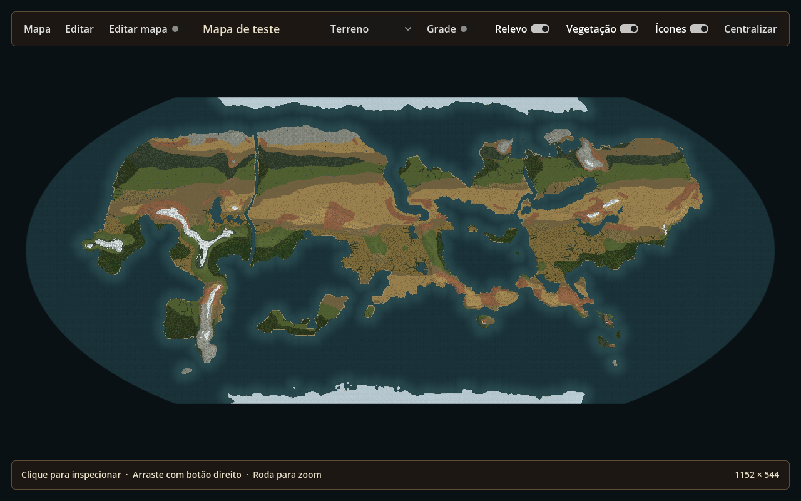
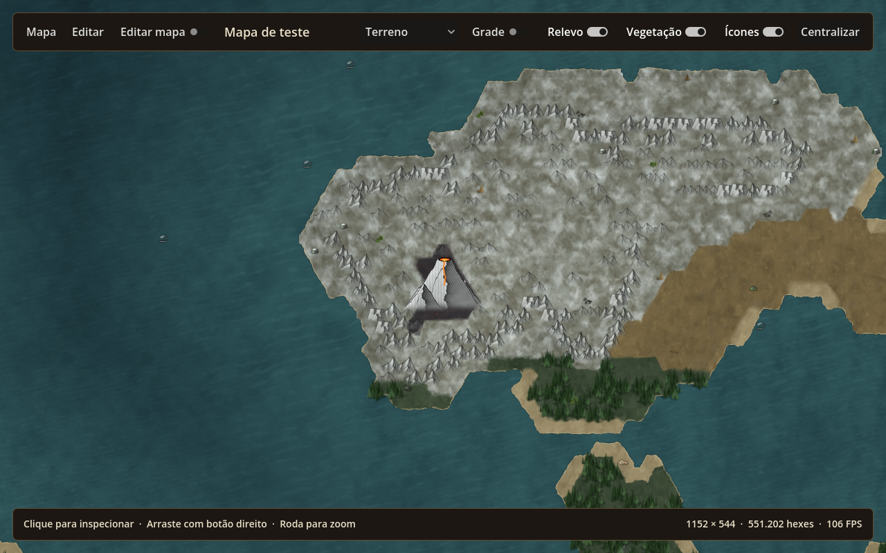
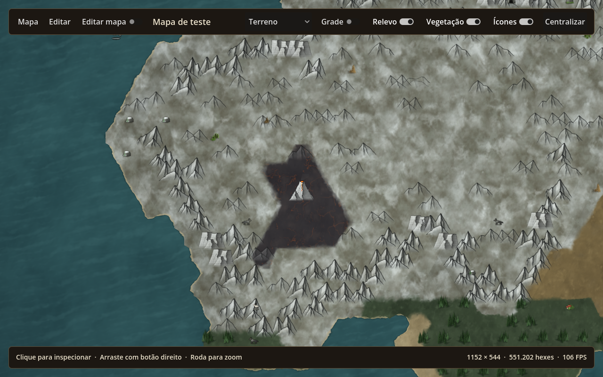

# Geleiras e vulcões — gerador v48

## Geleiras

O ruído do gelo passa a usar interpolação contínua. A calota afina gradualmente antes da margem oceânica lateral, com um afastamento irregular, em vez de preencher uma forma que seria cortada pela margem. As ilhas de gelo também perdem força antes do limite interno da placa polar. A base continua ligada às bordas norte e sul; placas laterais, cotas e exclusão da faixa polar da porcentagem de terra permanecem respeitadas.

## Vulcões

- O símbolo passa para um overlay esparso, desenhado depois do terreno, das montanhas e da vegetação. As montanhas vizinhas deixam de cobrir a cratera.
- No zoom afastado, o símbolo ocupa aproximadamente seis hexes de largura. Entre os níveis de zoom 12 e 22, diminui suavemente até a largura normal de 1,35 hex. O botão Relevo e a seleção de camada controlam sua visibilidade.
- O overlay reaproveita as três artes existentes, com escolha determinística por centro, e acompanha instalação do mapa, edição, cancelamento e regeneração.
- A área dos aventais vulcânicos cai para metade da receita v47, arredondada por ilha; os centros são preservados. A forma antiga serve apenas para calcular a área disponível.
- A nova propagação parte simultaneamente dos centros, permanece conectada e segue o relevo da ilha. Descidas têm custo menor, subidas e cristas têm custo maior; ruído em duas escalas varia os caminhos. O fluxo pode alongar-se por um vale além do contorno antigo. Água, faixa costeira e terrenos baixos continuam bloqueados.

As mudanças físicas usam a receita v48 para mapas novos. O overlay também destaca vulcões já salvos nas versões anteriores, sem reescrever a geografia.

## Validação

- Build do aplicativo sem erros nem avisos.
- Testes de geração: calotas ligadas às duas bordas em três seeds; quota não polar exata; vulcões e aventais conectados; área reduzida pela metade; centros preservados; crista alta evitada; regeneração e salvar/abrir.
- Suíte completa do núcleo, testes do editor e smoke test do aplicativo passaram durante a implementação. A verificação específica de biomas foi repetida após o ajuste final da propagação.
- Revisão visual em três seeds, atlas 1152 × 544, incluindo zoom próximo e afastado. Verificados presença de todos os centros no overlay, ordem acima do terreno e largura nos dois extremos de zoom.

