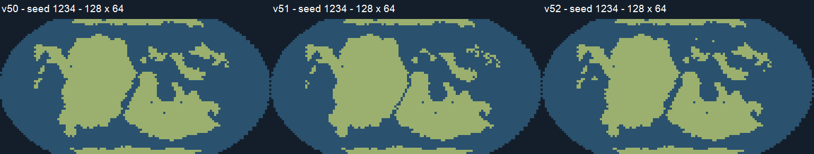
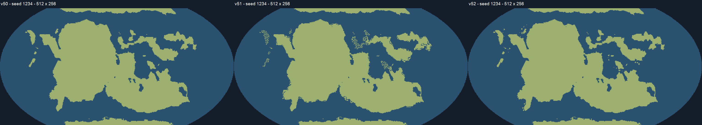
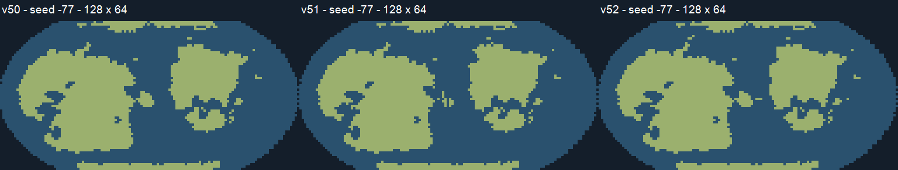
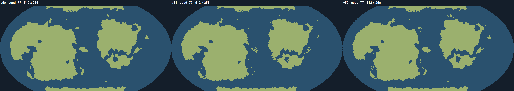
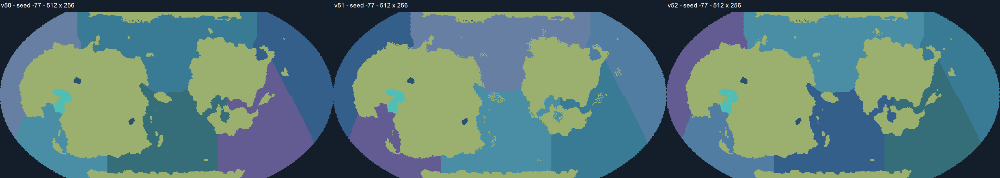

# Ilhas preservadas — gerador v52

## Correção

A receita v52 volta à máscara natural da v50 após `SculptWaterMargins`. Não aplica a fragmentação da v51. A função destrutiva permanece isolada como `ShapeSmallIslandsLegacy51`, exclusivamente para reproduzir a versão antiga e manter a regeneração regional compatível com seus saves.

`WorldGenerator.AdditiveIslands.cs` acrescenta ilhas em água marinha, entre três e nove hexes de distância da terra, dando preferência a ilhas existentes e levantamento tectônico. Cada adição tem 3–9 hexes, ou um hex quando existe uma ilha/grupo próximo. Nenhuma ilha original é removida, perfurada, unida ou redimensionada.

O orçamento é de até 0,3% da terra não polar anterior à etapa, limitado a 192 hexes e 24 adições por mapa. Uma adição só acontece se houver compensação disponível na costa continental próxima, num raio de 16–32 hexes. A compensação usa operações de ponto simples, que preservam as conexões de terra e água; evita pontes, buracos interiores e relevo tectônico forte. Cada continente perde no máximo 1% de sua área nessa etapa. Se a compensação local não comportar a ilha inteira, a tentativa é revertida.

Isso preserva exatamente a quota de terra. Não há obrigação de preencher o orçamento nem de criar a mesma quantidade de ilhas em todas as seeds.

## Verificação das ilhas

Comparação v50/v52 em três seeds, com e sem wrap, em 128 × 64 e 512 × 256. Os testes verificam cada componente terrestre original, não apenas contagens: identidade e conectividade preservadas, ilhas com área idêntica, continentes sem divisão/fusão, adições limitadas e quota exata. A própria v51 é usada como controle negativo e é rejeitada por esses critérios. Também são verificados determinismo e percentuais de terra 0, 5, 35 e 100.

Resultados em 512 × 256:

| Seed | Wrap | Ilhas de 3–9, v50 → v52 | Ilhas secundárias maiores, v50 → v52 | Ilhotas de 1, v50 → v52 |
| --- | --- | --- | --- | --- |
| 1234 | Não | 3 → 18 | 11 → 11 | 1 → 10 |
| 1234 | Sim | 4 → 17 | 16 → 16 | 0 → 11 |
| 1 | Não | 3 → 20 | 3 → 3 | 0 → 7 |
| 1 | Sim | 6 → 19 | 20 → 20 | 1 → 12 |
| −77 | Não | 3 → 20 | 11 → 11 | 1 → 8 |
| −77 | Sim | 0 → 18 | 8 → 8 | 0 → 6 |

Comparação visual das mesmas seeds e parâmetros: v50 à esquerda, v51 no centro, v52 à direita. As imagens são máscaras de diagnóstico, sem arte e rótulos do Godot. A revisão confirma a preservação dos contornos e a remoção do aspecto perfurado nas ilhas secundárias.









Para reproduzir as máscaras, na raiz do projeto:

```powershell
dotnet run --project tests/GeneratorChecks -- --ocean-islands-only --island-review
./tests/GeneratorChecks/Review-Islands.ps1
```

Os JSONs e as imagens de diagnóstico ficam em `.godot/island-review52/`.

## Compilação e regressões

O build do Godot/.NET terminou com zero erros e zero avisos. A suíte completa `GeneratorChecks` terminou com `All generator checks passed.` e código 0, cobrindo formatos, regiões, biomas, geleiras/vulcões, clima existente, relevo, tectônica, quotas, saves, locks e regeneração regional. Os checks finais específicos de ilhas e opções de placas também passaram.

A suíte revelou uma diferença de máscara entre as etapas Terra e Terreno completo: a seleção das novas ilhas lia levantamento bruto numa etapa e relevo líquido na outra. A v52 agora usa o mesmo relevo líquido nos dois casos. O teste de opções de placas confirma máscaras idênticas, inclusive em dimensões ímpares e configurações extremas.

## Verificação dos oceanos e mares

O classificador continua na versão 2. Não houve reversão de suas regras nem alteração do formato dos catálogos.

Os fixtures confirmam oceanos laterais distintos e amplos, água aberta rasa com muitas ilhas sem falsos mares, baía continental de abertura limitada reconhecida como mar e canal com duas saídas reconhecido como oceano. Os checks de regiões cobrem nomes/IDs estáveis por sobreposição, renomeação, cópia, persistência e arquivos sem camada opcional.

A revisão visual das duas seeds, em ambos os tamanhos, mantém bacias principais amplas. A baía continental da seed −77 é reconhecida como mar no mapa grande. A regra de cercamento continua heurística. Em mapas pequenos existem bolsas de 2–3 hexes de água polar abertas no limite superior, sem ligação interna a outra bacia: recebem uma região oceânica própria. Não são os oceanos principais, mas esse tratamento de água cortada pela borda merece revisão específica.



## Saves e publicação

Abrir um save não modifica sua geografia. Regenerar um save v51 continua reproduzindo a v51. Para obter a correção é necessário gerar pela mesma seed e parâmetros usando o gerador v52. Não há migração automática que reconstrua ilhas e preserve edições manuais.

Nenhum reset, commit ou publicação foi feito. O HEAD conferido foi `3ae891f`, release Alpha 1.1.32; a versão de publicação permanece a mesma. v52 é a versão interna da receita nesta árvore de desenvolvimento.

## Dependências e clima ainda pendentes

A correção desta rodada está restrita às ilhas e à revisão marinha. A identificação física global antes do clima ainda precisa ser separada dos nomes/rótulos de `GeographicRegions.Build`. O clima continua substituindo a influência marítima pela umidade de `regionalRain.Moisture` em `WorldGenerator.cs`; essa dependência precisa ser removida na nova implementação.

`SeparatePlateContinents` continua criando canais após as forças tectônicas: seus custos usam altura relativa ao mar, sem penalidade explícita para atravessar colisões. A revisão desses canais permanece necessária antes de integrar o novo clima.

Não foram implementados nesta rodada ventos 2D, abastecimento atmosférico por evaporação térmica, controles de ±5 °C/±10% de precipitação, sazonalidade, gelo marinho nem preenchimento automático da feature escarpa. O próximo trabalho deve primeiro resolver essas dependências, mantendo a geografia fixa durante o cálculo climático anual.
