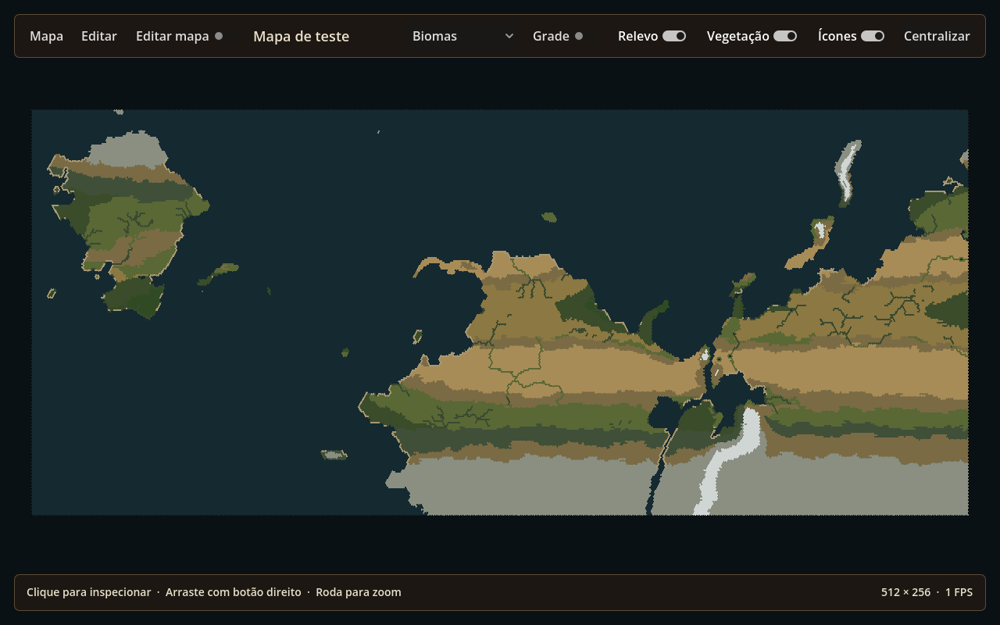
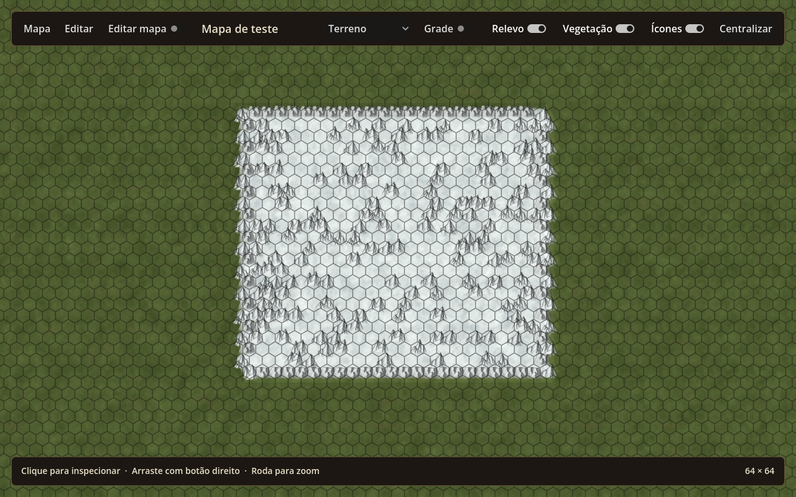

# Maioria dos biomas e agrupamentos de montanhas — v45

## Propagação para reduzir listras

O consolidado anterior olhava principalmente componentes pequenos. Uma faixa estreita, mas muito comprida, continuava sendo uma região grande e escapava desse filtro. A v45 acrescenta uma votação de vizinhança depois do ruído das bordas e antes da consolidação.

São três passagens simultâneas: raio regional `clamp(altura / 96, 3, 24)`, aproximadamente metade desse raio (mínimo 2) e os seis vizinhos imediatos. O bioma muda somente quando pelo menos quatro dos seis pontos concordam, há ao menos cinco amostras válidas, o clima aceita o destino e a regra de áreas abertas permite aquela cobertura. Empates conservam o bioma atual. Uma célula já absorvida não volta ao bioma anterior na passagem seguinte, evitando alternância entre escalas.

Praia, alpino e swamp são protegidos. A votação não atravessa água ou esses habitats ao procurar o bioma vencedor; locks são respeitados. A janela de regeneração inclui a soma dos alcances, e as leituras usam cópias por passagem para não depender da ordem de processamento. Água, altitude, temperatura e chuva ficam intactas.

Isso trata faixas estreitas de transição compatíveis com o entorno. Cinturões climáticos largos e regiões áridas/incompatíveis com os vizinhos continuam existindo.

## Montanhas em grupos menores

Além dos contornos contínuos e dos prolongamentos existentes, as montanhas comuns a partir de 1.400 m podem formar grupos em regiões classificadas como montanhosas. O interior alto/alpino também mantém seus grupos.

A densidade passa a variar por manchas de ruído com contraste maior, concentrando as peças em certos lugares e deixando clareiras entre os grupos. Montanhas comuns usam densidade menor que os grupos de cumes a partir de 4.800 m. O relevo salvo não é modificado: essa parte é somente a distribuição das artes e também aparece ao reabrir mapas antigos.

## Resultados e verificação

- Fixture de faixa longa com 640 hexes, cinco linhas de largura: 606 absorvidos sem wrap e 631 com wrap, preservando o lock. O caso árido incompatível mantém o bioma; praia, alpino e swamp não são apagados.
- Fixture homogênea de 1024 × 512: 58.645 símbolos de montanhas comuns contra 108.559 na região de cumes. As manchas densas tiveram aproximadamente 5,6 vezes a ocupação das manchas esparsas, confirmando agrupamento em vez de distribuição uniforme.
- Comparação real 512 × 256, seed 1234: 1.155 biomas ajustados, com máscara de água, elevação, temperatura e chuva idênticas à v44.
- Build sem erros ou avisos; testes do núcleo com clima, habitat, locks, wrap, determinismo e regeneração. Revisões nativas da votação e do relevo/editor, além do smoke de 524.288 hexes.

Biomas anteriores:

Depois da votação:

Agrupamento nas terras altas:

Comandos: `dotnet run --project tests/GeneratorChecks/GeneratorChecks.csproj --no-restore` (ou `-- --majority-only` para a votação). No Godot: `--biome-majority-review`, `--terrain-classification-review` e `--smoke-test --current-generator-only`.

A nova distribuição de biomas vale para mapas novos v45. As artes de montanhas são derivadas ao abrir mapas, sem alterar a geografia salva.
