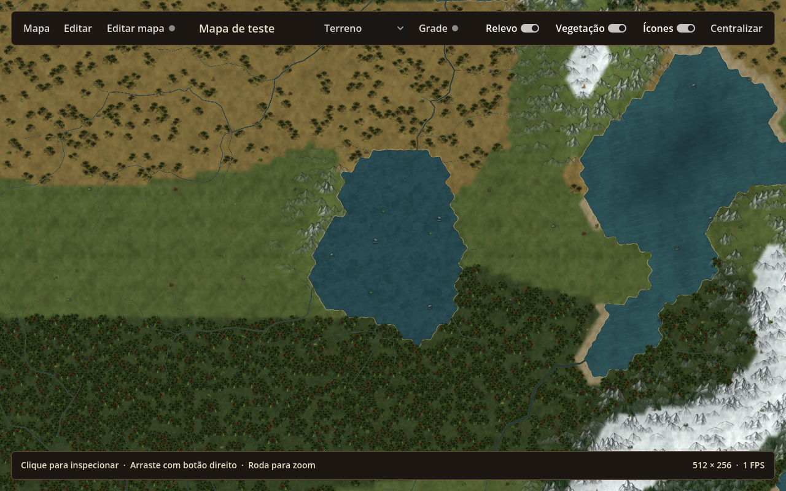
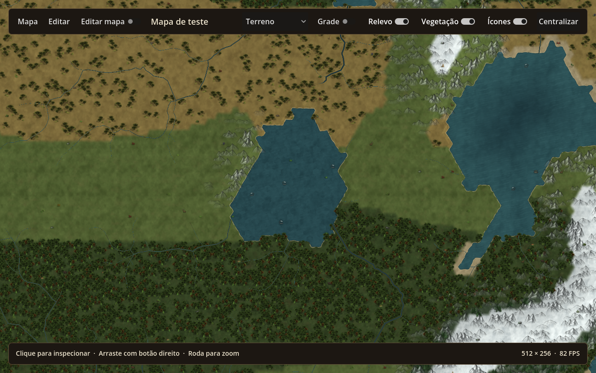

# Margens de água — gerador v42

## Diagnóstico

Na receita tectônica atual, lagos não são círculos aplicados por um pincel. A crosta, as forças tectônicas e o ruído produzem um campo de altitude; um limiar escolhe terra/água mantendo a cota de terra. A água conectada às bordas é rotulada como oceano, e a água fechada como lago.

Dois mecanismos reforçavam os formatos repetidos: a dilatação dos canais de separação usava largura constante, e o renderer arredondava as margens por interpolação quadrática. O campo de altitude já tinha ruído, mas não havia uma etapa de remodelagem das margens.

## Alterações

- Canais de separação são alargados por distância ponderada por ruído espacial contínuo da seed. A expansão continua conectada ao canal original e respeita os núcleos terrestres protegidos.
- Após separar os continentes, uma faixa rasa junto às margens recebe pequenas trocas entre terra e água. A preferência combina altitude e ruído em várias escalas, com deformação de coordenadas, para formar recortes e saliências.
- Cada erosão é compensada por uma adição na mesma massa terrestre: sua área permanece exata. A operação verifica a vizinhança hexagonal antes de cada troca, preservando a conectividade de terra e água. Não pode unir lagos separados, cortar um istmo ou fechar um escoamento. Adições exigem apoio de terra em pelo menos três vizinhos, evitando novos dedos finos.
- A faixa tem até `altura / 128` hexes, limitada a 1–24, e o orçamento de trocas é limitado a 1,2% dos hexes ativos. O custo de avançar para dentro cresce com a distância e com a altitude: o ruído não escava o interior das montanhas.
- Polos e margens oceânicas obrigatórias ficam fora das células elegíveis. A porcentagem de terra continua usando sua base original, com o oceano polar excluído.
- O renderer reduz a mistura com a curva arredondada, mantendo ruído fino e suavização de pixels. Terreno, rios e máscara de limpeza usam a mesma regra costeira.
- A receita e o estilo visual novos são ativados somente a partir da versão 42. Mapas anteriores conservam a receita e o estilo anteriores. Os pincéis geométricos do editor continuam com seus formatos explícitos.

O rebaixamento tectônico original permanece igual. Esta etapa remodela margens; não implementa uma simulação de níveis de água por bacia.

## Comparação no renderer

Mesma seed, resolução 512 × 256 e 38% de terra: **49.807 hexes terrestres em ambas as versões**. As duas imagens usam a mesma posição e zoom. A receita completa pode redistribuir a área entre lagos e oceano, mantendo a cota terrestre.

Antes (v41):

Depois (v42):

## Verificação

- Build .NET sem erros ou avisos.
- Fixtures com lagos elípticos, ilha e saída de um hex: determinismo, mudança por seed, áreas de todas as massas terrestres e quantidade de componentes de terra/água preservadas, com e sem wrap.
- Canal controlado: largura variável, expansão conectada e núcleos protegidos intactos.
- Suíte de geração: cotas de 10%, 38% e 65%, polos/laterais, contagem/separação de continentes, causalidade tectônica, regeneração regional, determinismo e save/load.
- Comparação visual nativa `--water-shapes-review` e teste `--river-clearance-review` para o recorte de vegetação/ícones.

Comandos: `dotnet build Mapmaker.csproj --no-restore`; `dotnet run --project tests/GeneratorChecks/GeneratorChecks.csproj --no-restore` (ou `-- --water-only` para as novas fixtures).
