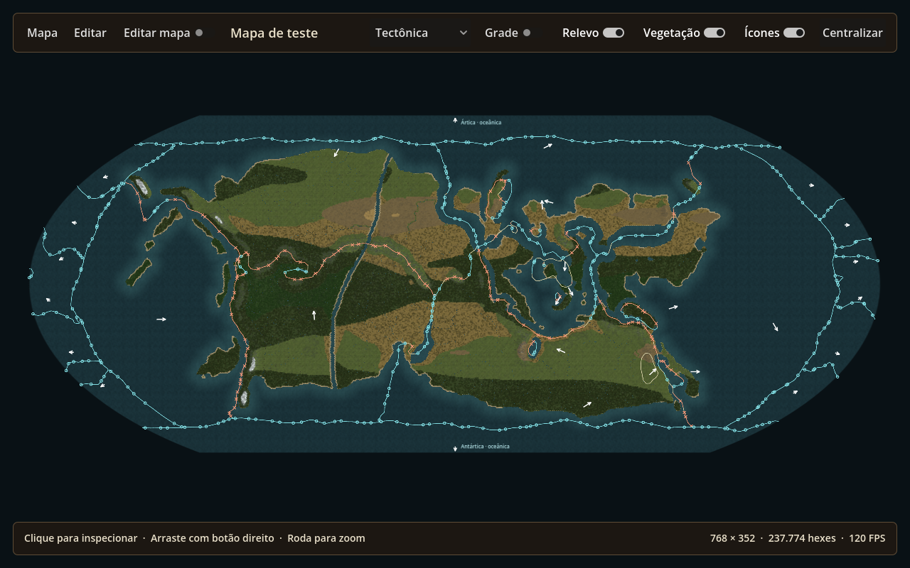

# Margens oceânicas fragmentadas — v40

Novos Mundos recebem entre seis e doze pequenos fragmentos oceânicos em cada lateral curva, conforme o tamanho do atlas. Eles são adicionais às placas comuns e polares, têm centros, velocidades, contatos reais e limites irregulares por seed. O contorno interno da faixa acompanha a curvatura do atlas com ruído em duas escalas.

A mesma faixa define a propriedade das placas e o oceano reservado na superfície. O campo de crosta incorpora a distância ao oceano lateral, e a geração impede terra e elevação positiva nessa faixa. O ajuste do nível do mar e a reposição de terra após separar continentes também respeitam essa reserva. Isso impede continentes ou ilhas encostados nas laterais do atlas.

Os novos fragmentos não consomem o orçamento de placas comuns nem alteram a escala calculada a partir desse total. Seus contatos de afastamento participam fisicamente do terreno. A prioridade da Ártica e da Antártica continua preservada nos encontros com os polos. Região e versões anteriores mantêm suas receitas.

## Porcentagem de terra

A tectônica não sobrescreve o percentual escolhido. Ela define a distribuição do terreno; o nível do mar é ajustado e a quantidade de terra é corrigida para o alvo exato em hexes inteiros. A separação dos continentes mantém essa quantidade.

A base continua sendo todos os hexes úteis fora das placas polares. O oceano lateral entra nessa base e na porcentagem de água. Somente os polos e os cantos fora do atlas são excluídos.

No renderer real, um Mundo de 768 × 352 com alvo de 38% resultou em 78.985 hexes de terra em 207.856 hexes não polares: **37,9999%**. A diferença é o arredondamento para hexes inteiros.

## Validação

- Build sem erros ou avisos; suíte completa do gerador e smoke test passaram.
- 36 casos de atlas, mais a matriz de polos nas versões 38, 39 e 40: três seeds, com/sem wrap e 10/38/65% de terra.
- Fragmentos pequenos e oceânicos em ambas as laterais, com contatos reais e centros dentro da faixa; bordas curvas cobertas sem terra, biomas terrestres ou elevação positiva.
- Quantidade exata de terra medida independentemente a partir dos hexes não polares. No caso pequeno da seed 1234: 10% → 1.416/14.162; 38% → 5.381/14.162; 65% → 9.205/14.162.
- Determinismo, regeneração de água/elevação/biomas e salvar/abrir preservados. Revisão visual no renderer passou.

Comandos: `dotnet run --project tests/GeneratorChecks/GeneratorChecks.csproj --no-restore`; Godot com `--smoke-test --current-generator-only` e `--ocean-frame-review`.
