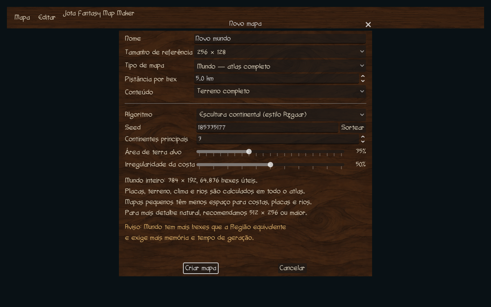
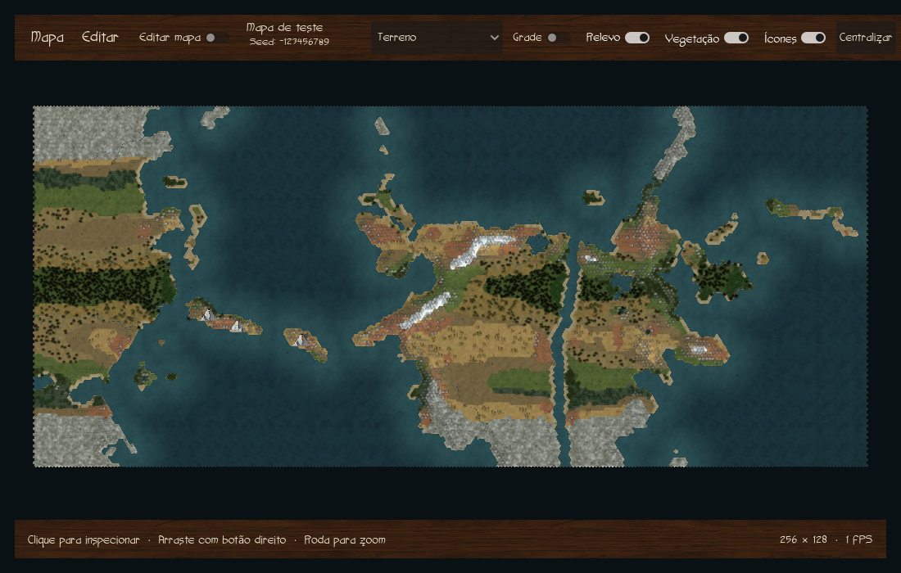

# Menus, sliders e seed — v49

- Terra: slider de 0 a 100%, em passos de 5%, com padrão 35%.
- Irregularidade da costa: slider de 0 a 100%, em passos de 10%, mantendo padrão 50%.
- Ambos exibem o valor percentual ao lado e aceitam teclado.
- A seed do mapa aberto fica no cabeçalho. Clicar nela copia o inteiro, incluindo o sinal, para a área de transferência.
- A textura de madeira desenhada foi aplicada às barras, painel inicial, menus, diálogos e fundo principal do editor.
- Faerie Moot Simple é usada nos controles; Faerie Moot Ornate nos títulos dos diálogos; Monster of Fantasy no título inicial. Os arquivos foram extraídos dos pacotes fornecidos em `Fontes/` para `assets/fonts/`.
- A janela compacta de 1100 × 700 preserva espaço para a seed e reduz a fonte dos controles à direita.

## Intervalo ampliado de terra

O núcleo passa a aceitar 0–100%. Região pode atingir 0% ou 100% de terra. Mundo continua protegendo margens oceânicas e deixando a faixa polar fora da quota; valores altos saturam na área elegível. O formulário explica essa limitação ao selecionar mais de 65% no Mundo. Se não houver espaço para compensar canais de separação em coberturas extremas, a geração preserva a superfície tectônica e a quota, sem falhar tentando forçar novos canais.

Receitas anteriores e arquivos já salvos continuam compatíveis. Os novos ajustes são registrados na receita v49.

## Validação

Build sem erros nem avisos. Testados 28 cenários com 0, 5, 35, 65, 70, 95 e 100% de terra em Mundo/Região, com e sem wrap: cotas regulares exatas, extremos válidos e oceanos obrigatórios preservados. Também passaram os testes de biomas, regeneração e salvar/abrir, além do fluxo do editor com 24 operações de regeneração.

A revisão nativa da interface verificou os limites, passos e padrões dos sliders, o evento de copiar seed e a leitura completa da seed em 1100 × 700. O teste de cópia intercepta o destino do texto para preservar a área de transferência do usuário.

[Textura e prompt da geração](../docs/Wood_Menu_Generation.md).
