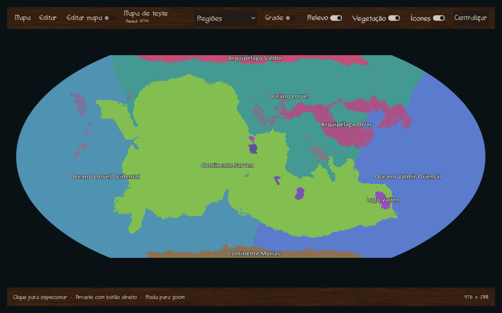
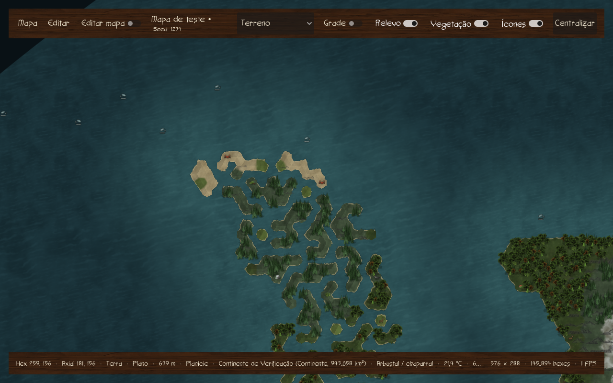

# Oceanos, mares e ilhas pequenas — v51

## Classificação marinha

- A água aberta passa a ter dois pontos de origem protegidos, próximos dos lados oeste e leste. Com pelo menos dois hexes marinhos disponíveis, eles ficam em oceanos distintos, inclusive com wrap. Se ficarem pequenos, incorporam bacias oceânicas conectadas para formar oceanos principais, sem se fundirem entre si.
- Placas oceânicas continuam orientando bacias adicionais. Divisões pequenas abertas são incorporadas às vizinhas; água rasa sozinha não gera mais um mar.
- Um mar exige cercamento por massas continentais: pelo menos cinco das seis direções de sondagem encontram continente, e sua borda continental tem pelo menos o dobro da extensão das interfaces com outras bacias marinhas.
- A abertura para outras bacias deve formar no máximo uma passagem conectada. Um corredor aberto nos dois extremos continua oceânico.
- Ilhas e arquipélagos não contam como paredes continentais nesse teste. Corpos interiores classificados fisicamente como lagos continuam sendo lagos.
- Os mínimos gerais de tamanho continuam orientando a fusão das subdivisões, mas a garantia dos dois oceanos laterais tem prioridade. Sem água marinha suficiente, a classificação não inventa água nem divide um único hex.

## Geração das ilhas

A receita v51 acrescenta uma etapa depois da remodelagem das costas e antes do gelo polar e da identificação de mar aberto:

1. Identifica as massas terrestres existentes. Preserva as principais, as de tamanho continental e alguns núcleos pequenos de forte levantamento tectônico.
2. Seleciona ilhas secundárias acima de nove hexes para fragmentação. Os novos grupos permanecem dentro da área da ilha de origem, acompanhando a distribuição tectônica que a criou.
3. Conserva cerca de 45% da área selecionada em manchas conectadas de 3–9 hexes, com crescimento irregular por seed. Mantém canais entre as manchas.
4. Permite ilhotas de um hex junto de grupos já estabelecidos. A maioria das novas ilhas fica na faixa de 3–9; algumas ilhas maiores continuam presentes.
5. Redistribui a terra removida nas costas principais, preservando conexões e a quota global. Se não houver compensação topologicamente válida, restaura a máscara original em vez de perder terra.

O agrupamento nominal em arquipélago passa a ter mínimo absoluto de oito hexes, permitindo reconhecer conjuntos pequenos mesmo em mapas grandes. Os rótulos continuam dependendo do zoom e do espaço disponível.

## Compatibilidade

As novas formas das ilhas exigem criar um mapa com a receita v51. Mapas anteriores mantêm sua geografia física.

O classificador de regiões passa à versão 2. Catálogos da versão 1 continuam abrindo e são atualizados quando usados. Nomes e IDs são reaproveitados onde há correspondência de área e categoria; fusões e mudanças de categoria podem gerar novas identidades.

## Verificação

Build sem erros nem avisos. Passaram a suíte completa do núcleo, as 24 operações de regeneração do editor e a revisão visual com renomeação/salvar/abrir em três seeds. Também passaram os 28 cenários de quota de terra de 0 a 100%, em Mundo/Região e com/sem wrap.

Testes específicos confirmam os dois oceanos protegidos, água aberta rasa cercada de pequenas ilhas sem falsos mares e uma baía continental reconhecida como mar.

Comparação em 512 × 256, com exatamente a mesma quantidade de terra não polar antes e depois:

| Seed | Wrap | Ilhas de 3–9, antes → depois | Ilhas maiores secundárias, antes → depois |
| --- | --- | --- | --- |
| 1234 | Não | 3 → 104 | 11 → 1 |
| 1234 | Sim | 4 → 119 | 16 → 0 |
| 1 | Não | 3 → 19 | 3 → 0 |
| 1 | Sim | 6 → 145 | 20 → 2 |
| −77 | Não | 3 → 67 | 11 → 0 |
| −77 | Sim | 0 → 22 | 8 → 3 |

