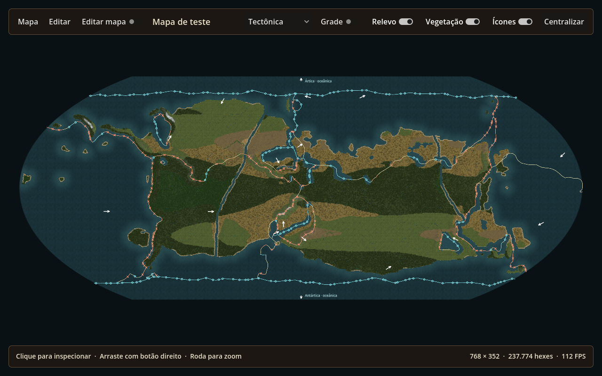

# Placas polares oceânicas — v38

Novos mapas do tipo Mundo recebem duas placas adicionais obrigatórias: Ártica e Antártica. Elas cobrem toda a parte reta do topo e da base do atlas. Região e mapas salvos em versões anteriores preservam suas receitas.

As fronteiras internas usam três escalas de ruído determinístico, com seeds independentes para norte e sul. O mesmo limite define a propriedade da placa, seus contatos e a reserva oceânica no terreno. As placas têm velocidades para fora do mapa e contatos sempre divergentes, representando o afastamento permanente pedido para os polos.

O campo de crosta incorpora a proximidade do oceano polar. As faixas permanecem submersas e não podem receber terra durante o ajuste do nível do mar ou a reposição de costas após a separação continental. A porcentagem de terra continua sendo calculada sobre todos os hexes úteis do atlas, incluindo o oceano polar. As placas polares não substituem as placas continentais e microplacas comuns.

Os papéis Ártica/Antártica são salvos junto das placas e identificados na camada Tectônica, preparando a futura geração de gelo centrado nelas. A textura fornecida foi guardada localmente como referência; não faz parte desta release, não foi aplicada ao renderer nem transformada em variantes nesta etapa.

## Verificação

- Build sem erros ou avisos.
- Suíte completa do núcleo passou, incluindo os 36 casos de atlas e regressões das versões anteriores.
- 18 combinações polares: três seeds, com/sem wrap e 10/38/65% de terra. Confirmados cobertura das bordas retas, fronteiras variáveis, contatos divergentes e ausência de terra, elevação positiva e biomas terrestres nas placas polares.
- Determinismo, regeneração regional, marcadores dentro da placa e salvar/abrir preservados.
- Smoke test da aplicação e revisão visual no renderer passaram.
- Maior atlas: 6144 × 2784, 15.044.776 hexes úteis; alvo de 38% resultou em 5.717.014 hexes de terra. 24.825 rios, nenhum término fluvial sem destino. Geração em 103,04 s nesta máquina.

Reproduzir: `dotnet run --project tests/GeneratorChecks/GeneratorChecks.csproj`; Godot com `--smoke-test --current-generator-only`, `--maximum-generation --world-map` e `--ocean-frame-review`.
