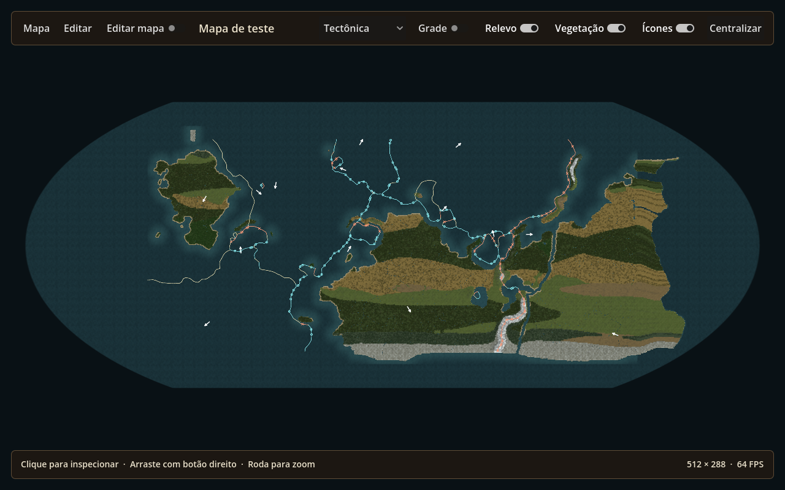

# Moldura com polos retos e hexes extras — v36

A moldura do modo Mundo agora tem topo e base horizontais, com laterais curvas, seguindo o formato da referência. O acabamento externo continua visual e não é editável. O recorte mantém oceano entre as costas e o contorno.

Mapas Mundo novos recebem **6,25% da altura central em linhas de hexes ao norte e mais 6,25% ao sul**, arredondadas para um número par de linhas para preservar o alinhamento dos hexes. Exemplos:

| Área central | Linhas por lado | Mapa total |
| --- | --- | --- |
| 256 × 128 | 8 | 256 × 144 |
| 512 × 256 | 16 | 512 × 288 |
| 4096 × 2048 | 128 | 4096 × 2304 |

As linhas são dados reais do mapa: podem ser selecionadas, pintadas, salvas e regeneradas. A parte interna prolonga de forma irregular a costa existente, baixando o relevo em direção ao mar; a faixa externa permanece oceânica para dar espaço aos polos retos. A porcentagem de terra continua definida sobre a área central, excluindo essas linhas extras e a moldura visual.

## Preservação da área central

A área central é gerada primeiro com suas dimensões, seed e parâmetros originais e depois deslocada para acomodar o norte. Seus campos de água, elevação, bioma, temperatura e chuva são copiados sem recalcular. O deslocamento par preserva os vizinhos da malha hexagonal.

As placas e os contatos recebem o mesmo deslocamento vertical. Os caminhos dos rios são reindexados e os que terminavam na antiga borda norte/sul continuam pelas novas linhas até o oceano. As referências de confluências, níveis e vazões são preservadas. A regeneração extrai a área central e respeita os campos selecionados e locks ao recompor a seleção.

`GenerationSettings.PolarOceanRows` registra a quantidade por lado. Arquivos antigos sem esse campo conservam suas dimensões. O contorno visual reto também é aplicado aos Mundos v35 já existentes, mas adicionar linhas reais exige criar um Mundo v36; abrir um arquivo não altera sua grade.

## Verificação

- Build sem erros ou avisos.
- Mesmos dados centrais de água, elevação, biomas, temperatura e chuva antes/depois da expansão.
- Porcentagem central de terra exata e oceano nas novas bordas polares externas.
- Grade vazia, terra/água, relevo e terreno completo, com e sem wrap.
- Placas deslocadas, caminhos fluviais válidos, salvar/abrir, regeneração cruzando centro/polos, preservação de água/elevação e locks.
- Formulário: dimensões centrais, cálculo das linhas extras, restauração de um mapa existente e metadados sem duplicar padding.
- Captura no renderer real: topo e base retos, laterais curvas, hexes polares selecionáveis e moldura externa não selecionável.
- Teste geral direcionado à v36 passou.
- Teste máximo com área central de 4096 × 2048 e total de 4096 × 2304 passou em 42,19 s, com 16.917 rios e nenhum término fluvial sem destino.

Reprodução: `dotnet run --project tests/GeneratorChecks/GeneratorChecks.csproj`; Godot com `--smoke-test --current-generator-only`, `--maximum-generation --world-map` e `--ocean-frame-review` (renderer gráfico para a captura).
