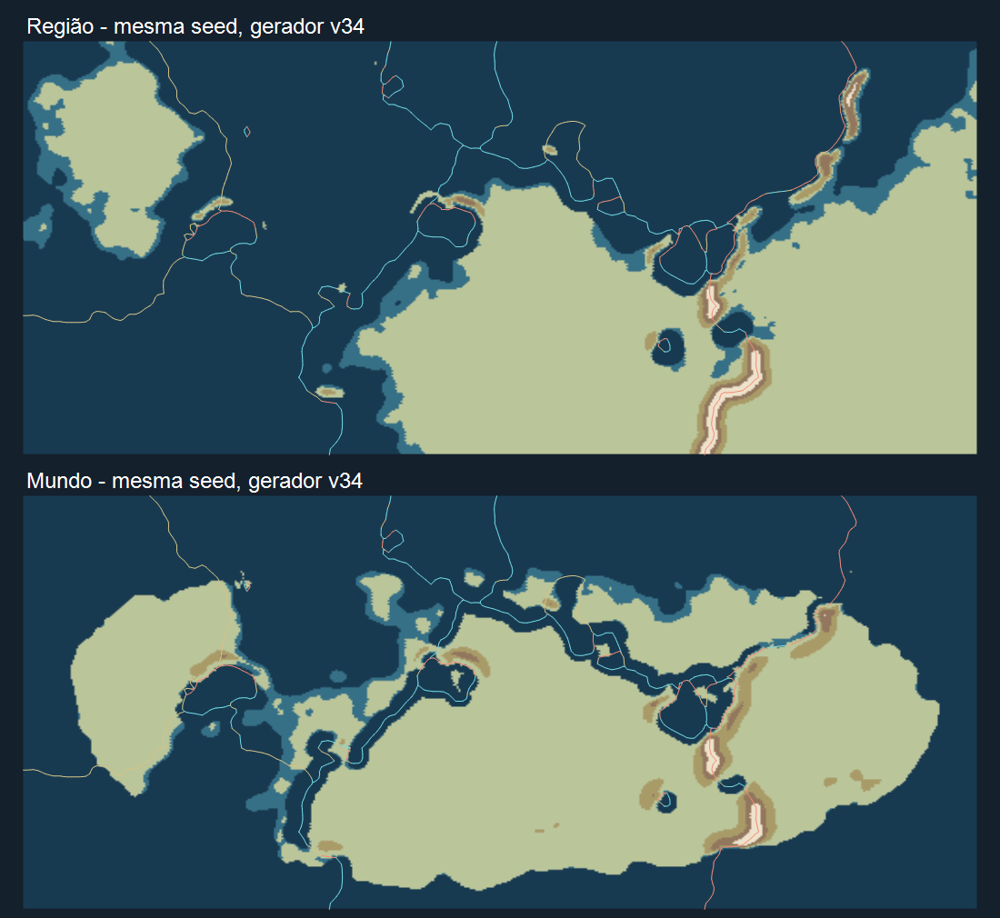

# Região e Mundo — gerador v34

O formulário de criação agora oferece **Tipo de mapa**:

- **Mundo — oceano ao redor**: padrão para mapas novos. Reserva oceano na periferia de uma elipse inscrita nas dimensões escolhidas. A transição altera apenas a faixa externa do campo geológico, com variação pela seed para produzir baías e penínsulas. O número de hexes e o percentual global de terra permanecem os selecionados.
- **Região — recorte aberto**: conserva o comportamento da v33, permitindo que terra e relevo continuem para além das bordas do retângulo.

A preferência confirmada para esta implementação foi manter o oceano **dentro das dimensões escolhidas**, sem adicionar área externa ao mapa.

O modo Mundo combina a queda periférica com o campo tectônico antes da escolha global do nível do mar. Ilhas, montanhas, águas, clima, rios e biomas são processados sobre essa superfície. A faixa de raio elíptico normalizado a partir de 0,97 é sempre oceânica na geração; o editor continua permitindo alterações manuais.

A reserva de oceano redistribui parte da terra para o interior a fim de manter a porcentagem solicitada. Por isso Mundo e Região com a mesma seed compartilham a tectônica, mas podem ter costas diferentes também por causa do novo nível do mar.

`GenerationSettings.Extent` salva a escolha. A ausência desse campo em arquivos antigos significa Região, preservando sua geografia e sua receita de geração. O formulário restaura a escolha ao gerar terreno em um mapa existente, inclusive em uma grade vazia.

## Verificação

- Build sem erros ou avisos.
- Região v34 reproduziu exatamente água, elevação, biomas e chuva da v33 para a seed de regressão.
- Mundo: oceano, elevação negativa e ausência de biomas terrestres em toda a faixa externa; nenhum rio encerrado na borda retangular.
- Dimensões e quantidade exata de terra mantidas, inclusive com 65% de terra, formato vertical, dimensões ímpares e wrap.
- Máscara de água consistente entre geração só de terra/água e terreno completo.
- Salvar/abrir e regeneração regional preservaram o modo e a borda oceânica.
- O formulário foi exercitado no teste do Godot: padrão Mundo, seleção Região, envio do manifesto e restauração de ambos os modos.

Reproduzir com `dotnet run --project tests/GeneratorChecks/GeneratorChecks.csproj -- --extent-review`. O teste Godot direcionado à versão atual usa `--smoke-test --current-generator-only`. O teste máximo no modo Mundo usa `--maximum-generation --world-map`.

O teste geral direcionado à v34 passou. O modo Mundo também passou no tamanho máximo (4096 × 2048) em 42,56 s, com 3.187.671 hexes de terra e nenhum término fluvial sem destino.
