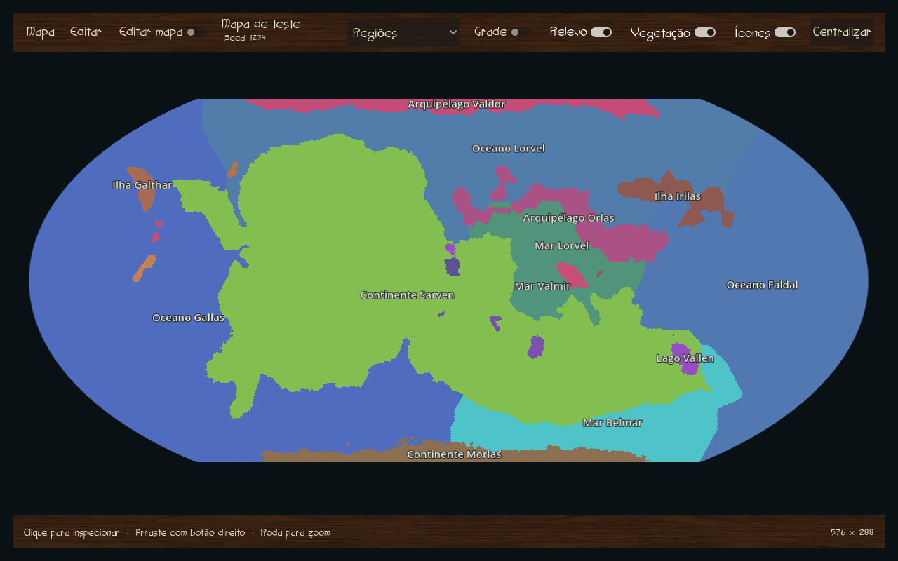

# Regiões geográficas — v50

As regras de mares, oceanos e arquipélagos foram atualizadas na [v51](Oceanos_Ilhas_v51.md). Os critérios abaixo documentam a versão inicial.

A camada **Regiões** identifica continentes, ilhas, arquipélagos, oceanos, mares e lagos. Cada hex útil pertence a uma região com ID, categoria, nome, área, posição de rótulo e elevação média. A classificação não altera altitude, água, bioma, tectônica ou porcentagem de terra.

## Regras

| Categoria | Critério inicial |
| --- | --- |
| Continente | Massa terrestre conectada com pelo menos 5% da terra e mínimo de 32 hexes |
| Ilha | Massa terrestre abaixo desse limiar |
| Arquipélago | Duas ou mais ilhas próximas; conjunto com pelo menos 0,1% da terra e mínimo de 8 hexes |
| Oceano | Bacia marinha com pelo menos 8% da água marinha e mínimo de 64 hexes |
| Mar | Bacia costeira/rasa abaixo do limiar de oceano; mínimo de 0,5% da água marinha e 12 hexes para conservar uma subdivisão |
| Lago | Corpo de água interior separado da água marinha, conforme o tipo físico de água salvo |

Os limites relativos acompanham o tamanho de cada mapa. Bacias pequenas são incorporadas às vizinhas com maior fronteira compartilhada. Um corpo marinho fisicamente isolado não é unido através de terra para satisfazer o mínimo; se ficar abaixo do tamanho de oceano, é classificado como mar. Rótulos pequenos aparecem somente quando há espaço na tela.

A quantidade de continentes nomeados depende das massas conectadas e desse limiar; ela não é uma cópia do parâmetro de continentes principais usado para orientar a geração.

As placas oceânicas comuns fornecem pontos de origem para as bacias. A expansão atravessa apenas água marinha e tem custo maior em águas rasas; continentes e estreitos condicionam as conexões. Placas polares e laterais especiais não criam pontos de origem independentes. Assim, as placas orientam a divisão, mas uma microplaca não garante um novo oceano. A classificação é cartográfica, sem simulação de correntes oceânicas.

Ilhas próximas são agrupadas por distância através da água; a água entre elas mantém sua própria região marinha. O alcance varia com a resolução, entre 2 e 24 passos por frente. Wrap e limites curvos são respeitados.

## Uso

Selecione **Regiões** no seletor de camadas. As cores diferenciam as regiões e os nomes têm contorno para leitura. Rótulos sobrepostos ou pequenos demais são ocultados. Clique em um hex para consultar nome, categoria e área; o tooltip inclui ID, quantidade de hexes, elevação média e placa-base quando disponível.

Use **Mapa → Renomear região selecionada…** para alterar o nome. Termine a edição do terreno antes de renomear. Os nomes são persistidos; mudanças geométricas reaproveitam IDs e nomes pela maior sobreposição dentro da mesma categoria. Divisões e fusões podem criar ou extinguir identidades. As cópias de edição mantêm nomes separados do original.

A região é reclassificada após alterações de terreno quando a camada está aberta e antes de salvar. Fora dessa camada, a classificação pode ficar pendente para evitar recalcular o mundo a cada pincelada. Integrações que modificam arrays diretamente podem chamar `InvalidateGeography()`; salvar também detecta mudanças de água e altitude.

## Arquivos e integração futura

O formato `.world` 2 recebe duas entradas opcionais: `geography.json`, com catálogo e versão do algoritmo, e `layers/geographic_regions.bin`, com IDs de 32 bits por hex. Arquivos antigos continuam abrindo e recebem a classificação ao ser utilizada. A leitura rejeita pares incompletos, IDs desconhecidos, áreas/âncoras incoerentes e regiões incompatíveis com a superfície.

`GeographicRegions.Get(world)` disponibiliza os IDs e as estatísticas para o futuro sistema climático. A geração atual prepara o catálogo em segundo plano antes de instalar o mapa na interface. Essa classificação não substitui o transporte de umidade existente.

## Verificação

Testes específicos verificam classificação, arquipélagos sem unir água, tectônica, determinismo, wrap, domínio curvo, conservação do terreno, nomes e IDs após alterações, cópias de edição, salvar/abrir, ausência da camada em saves antigos e corrupção de entradas.

A revisão no Godot cobre três seeds com a camada real, rótulos, inspeção, renomeação, persistência e editar/desfazer/refazer/cancelar. O fluxo geral do editor passou nas 24 operações de regeneração.

Build sem erros ou avisos, suíte completa `GeneratorChecks` aprovada e smoke test do aplicativo aprovado com 524.288 hexes, incluindo salvar/abrir em 0,936 s no ambiente de validação.

