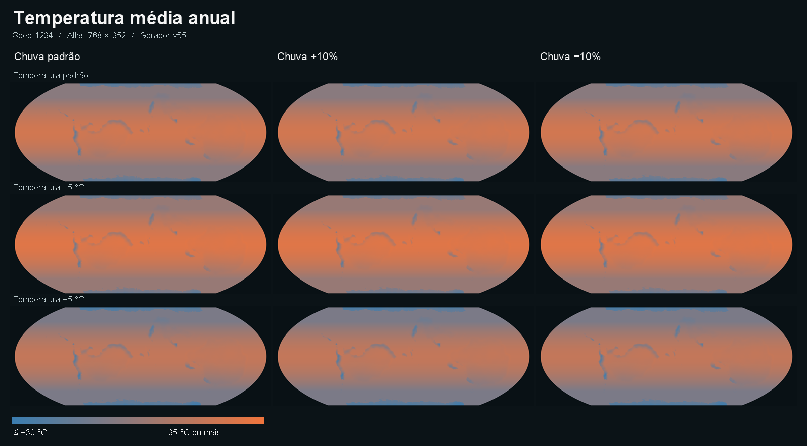
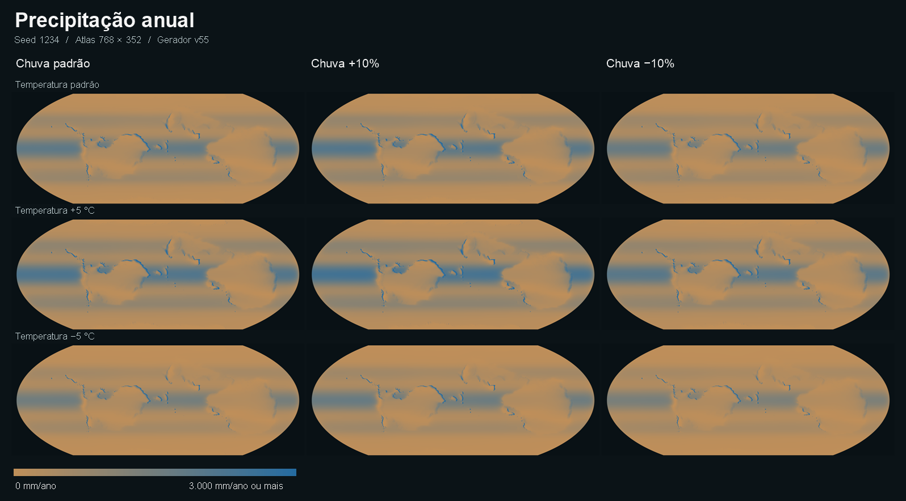
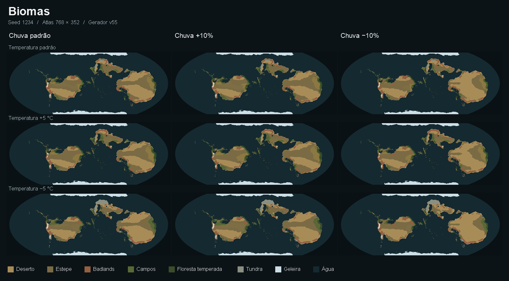

# Clima anual v55 — nove cenários em um atlas médio

Com a chuva no padrão, **+5 °C elevou a precipitação média terrestre de 398,1 para 473,7 mm/ano**. Com **−5 °C**, a média caiu para **326,3 mm/ano**. Nesse atlas, o efeito indireto da temperatura na chuva foi maior que o ajuste direto de ±10%. Em todas as nove gerações, água e altitude foram idênticas hex a hex.

### Como foi testado

Usei o gerador v55 no modo **Mundo**, com o preset médio de **512 × 256**, que produz um atlas de **768 × 352** com **237.774 hexes ativos**. Mantive a seed 1234, três continentes, 25% de terra, 80% de costa, terreno completo e wrap desligado. Cada cenário tem uma geração. As médias, os percentis e as mudanças de bioma abaixo usam os mesmos **51.964 hexes terrestres fora das faixas polares**. As imagens mostram o atlas inteiro.

### Temperatura

A leitura muda entre as linhas. Em cada linha, o ajuste de chuva deixa a temperatura idêntica em todos os hexes. As serras continuam mais frias que as baixadas próximas.

### Chuva

Compare as colunas para ver o efeito de ±10% sobre a quantidade de chuva. Compare as linhas para ver o efeito da temperatura sobre a umidade do modelo. A faixa equatorial e as manchas úmidas junto às serras mudam de intensidade, enquanto os interiores secos respondem de maneira mais discreta na escala global.

### Biomas

As mudanças se concentram nas transições entre deserto, estepe e outros biomas. Na linha mais fria, a tundra se expande na ponta norte da massa de terra central. A legenda mostra os biomas mais úteis para ler a comparação.

### Resultados por cenário

P90 é a chuva que 90% dos hexes terrestres recebem ou ficam abaixo. A última coluna compara cada cenário com **temperatura e chuva no padrão**.

| Ajuste térmico | Ajuste de chuva | Temp. média | Chuva média | Mediana | P90 | Hexes com outro bioma |
| --- | --- | ---: | ---: | ---: | ---: | ---: |
| Padrão | Padrão | 15,79 °C | 398,1 mm | 273 mm | 666 mm | 0 |
| Padrão | +10% | 15,79 °C | 437,9 mm | 300 mm | 733 mm | 6.045 (11,6%) |
| Padrão | −10% | 15,79 °C | 358,3 mm | 245 mm | 599 mm | 8.266 (15,9%) |
| +5 °C | Padrão | 20,79 °C | 473,7 mm | 303 mm | 831 mm | 13.499 (26,0%) |
| +5 °C | +10% | 20,79 °C | 521,0 mm | 333 mm | 914 mm | 17.949 (34,5%) |
| +5 °C | −10% | 20,79 °C | 426,3 mm | 273 mm | 748 mm | 11.019 (21,2%) |
| −5 °C | Padrão | 10,79 °C | 326,3 mm | 235 mm | 530 mm | 14.520 (27,9%) |
| −5 °C | +10% | 10,79 °C | 359,0 mm | 258 mm | 583 mm | 12.330 (23,7%) |
| −5 °C | −10% | 10,79 °C | 293,7 mm | 211 mm | 477 mm | 20.228 (38,9%) |

### O que os números mostram

- **Efeito do controle de chuva.** Na temperatura padrão, +10% reduziu o deserto de **18.139 para 15.709 hexes**. Com −10%, o deserto ocupou **22.272 hexes**. A transição mais comum foi de deserto para estepe no cenário úmido e de estepe para deserto no seco.
- **Efeito do controle térmico.** Com chuva no padrão, +5 °C trouxe **19,0% mais chuva média** e −5 °C trouxe **18,0% menos**. Na configuração fria, a tundra passou de **445 para 2.043 hexes**. O efeito combina evaporação, transporte, condensação e a resposta do modelo ao frio.
- **Médias parecidas podem produzir mapas diferentes.** Temperatura padrão com chuva −10% teve **358,3 mm/ano**. Temperatura −5 °C com chuva +10% teve **359,0 mm/ano**. Mesmo assim, o primeiro cenário teve **445 hexes de tundra** e o segundo **2.037**, além de diferenças na distribuição da chuva.
- **O cenário padrão ficou seco nesta seed.** A mediana foi de **273 mm/ano** e deserto, estepe e badlands somaram **74,0%** da terra analisada. Esse resultado mede um atlas. A frequência de mundos secos exige uma amostra com outras seeds e tamanhos.

A camada Chuva do Godot atinge o azul máximo em **3.000 mm/ano**. Entre **0,9% e 2,0%** da terra analisada atingiu esse limite visual, conforme o cenário. Os cálculos da tabela usam os valores armazenados pelo gerador.

Os nove cenários passaram na comparação automatizada da geografia, no deslocamento térmico exato e na verificação da chuva por hex dentro da margem de arredondamento. As gerações levaram **4,00 a 4,60 s** nesta máquina, sem incluir a captura.

[Dados brutos e transições por bioma](clima-v55/dados.json). As 27 capturas originais estão na mesma pasta. Para reproduzir as gerações e capturas, execute o projeto Godot em 1280 × 800 com `-- --annual-climate-review`.
