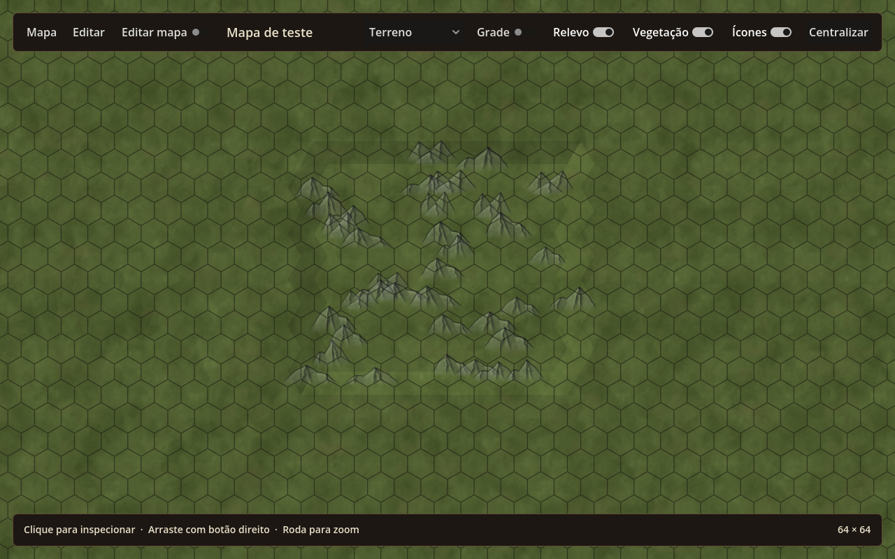
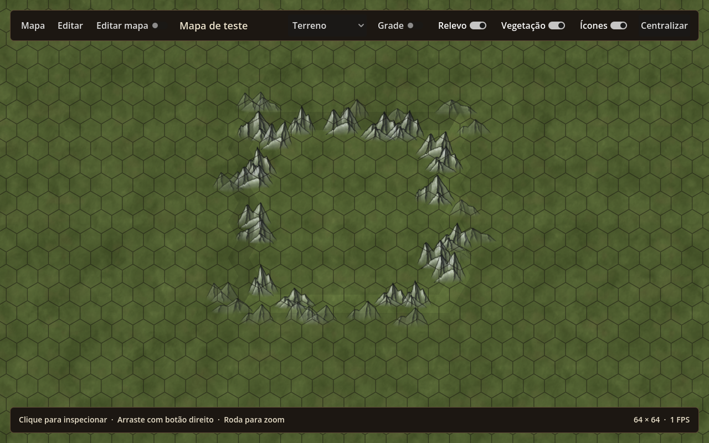

# Relevo e formas geográficas por desnível — v41

Novos mapas classificam a forma do terreno depois de calcular todas as elevações. Um topo alto e plano recebe `Plateau` e relevo `Flat` ou `Rolling`, enquanto as bordas com quedas importantes recebem montanhas/escarpas. Elevação alta sozinha não produz picos. A área baixa junto à encosta recebe sopé, sem repetir o símbolo de montanha da crista.

O passo não altera altitude, água, clima, biomas ou features. Os símbolos existentes de relevo passam a seguir essa classificação. A inspeção identifica planície, planície ondulada, planalto, escarpa/serra, morros, montanhas, pico, vale/depressão, encosta e sopé. As artes específicas de vulcão/cânion/escarpa serão integradas em outra etapa.

## Leituras e regras

São comparados os seis vizinhos imediatos e os seis pontos a `max(1, Height / 256)` hexes. Água e posições fora do domínio do atlas são ignoradas, evitando falsos paredões causados por fundo oceânico, profundidade de lagos ou cantos ocultos. Wrap participa da busca.

O classificador mede queda, subida, direções mais altas/baixas e vizinhos de altura semelhante. Para interpretação cartográfica, o desnível equivalente é ajustado por `clamp(5 / HexDistance, 0.05, 5)`: a mesma diferença de altura pesa mais em hexes pequenos e menos em hexes grandes. Isso não pretende medir o ângulo exato de uma face do terreno.

As regras são avaliadas em ordem:

- Pico: altitude de pelo menos 3.200 m, descida equivalente de pelo menos 400 m, queda real de pelo menos 250 m, três direções baixas e pouca subida acima do hex. Um planalto plano a 4.000 m continua plano.
- Montanha: descida equivalente de pelo menos 600 m e queda real de pelo menos 250 m. Se houver altitude de pelo menos 700 m e duas direções niveladas, identifica a borda como escarpa/serra.
- Vale/depressão: pelo menos três direções 250 m mais altas, quatro direções válidas e pouca queda abaixo do hex.
- Morros: descida equivalente de pelo menos 250 m e queda real de pelo menos 100 m.
- Encosta/sopé: subida equivalente de pelo menos 250 m e subida real de pelo menos 100 m. A partir de 600 m equivalentes, usa o nome sopé.
- Topos a partir de 700 m: planalto. O relevo é plano ou ondulado conforme o desnível equivalente seja menor ou maior que 100 m.
- Terreno baixo restante: planície ou planície ondulada.

## Geração, regeneração e edição

Na geração e regeneração v41, a classificação usa uma segunda passagem sobre as alturas prontas. A janela regional inclui o alcance necessário; amostras leem os valores reais, inclusive elevações travadas. Locks de relevo e forma geográfica são independentes. Nenhuma característica geográfica existente é removida pelo classificador.

Pincéis de elevação e água reclassificam os hexes alterados e os vizinhos que dependem deles ao terminar a pincelada. Respeitam a seleção ativa e os locks. A operação inteira, incluindo vizinhos em outros chunks, entra no mesmo undo/redo. A edição numérica de altitude/água também atualiza as dependências vizinhas.

O menu de regeneração oferece **Forma geográfica** para recalcular somente esse campo a partir das alturas atuais. Ele funciona também em mapas antigos. Regenerações de um campo específico preservam os demais campos; **manter terra/água e elevação** também preserva relevo e forma geográfica.

Saves anteriores mantêm sua receita: abrir não reclassifica o mapa. Editar altitude/água é uma ação explícita que usa o novo classificador local. A regeneração completa de versões antigas mantém a receita de relevo dessas versões.

## Verificação

- Build sem erros ou avisos; suíte completa do núcleo e smoke da aplicação passaram.
- Planalto, escarpa, sopé, planície, vale, pico real, topo elevado plano, face ascendente, escala física, resolução regional, wrap, água e domínio curvo.
- Comparação v40/v41: elevação, água, temperatura, chuva e biomas idênticos nas amostras testadas. O alvo de terra continua respeitado nos testes completos de atlas.
- Cordilheira controlada: elevação média de colisão de 3.902 m contra −3.350 m no afastamento; 172 hexes de montanha nas encostas da colisão contra zero no afastamento. O topo deixa de ser obrigado a exibir montanha só pela altitude.
- Determinismo, regeneração regional, seleção, locks independentes, features preservadas, undo/redo e salvar/abrir.
- No renderer real, o exemplo de 100 hexes a 1.200 m mantém o interior plano e concentra o relevo nas bordas.
- Editor real: pincel de elevação, atualização dos vizinhos, uma operação de histórico, undo/redo, locks e cancelamento. Fluxo geral com 22 regenerações, incluindo o campo Forma geográfica.

Antes, com classificação apenas por altitude:

Depois, preservando as mesmas alturas:

Comandos: `dotnet run --project tests/GeneratorChecks/GeneratorChecks.csproj -- --landforms-only`; suíte completa sem esse argumento; Godot com `--terrain-classification-review`, `--validate-editor-current` e `--smoke-test --current-generator-only`.
