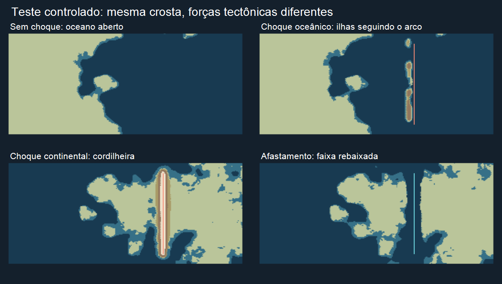
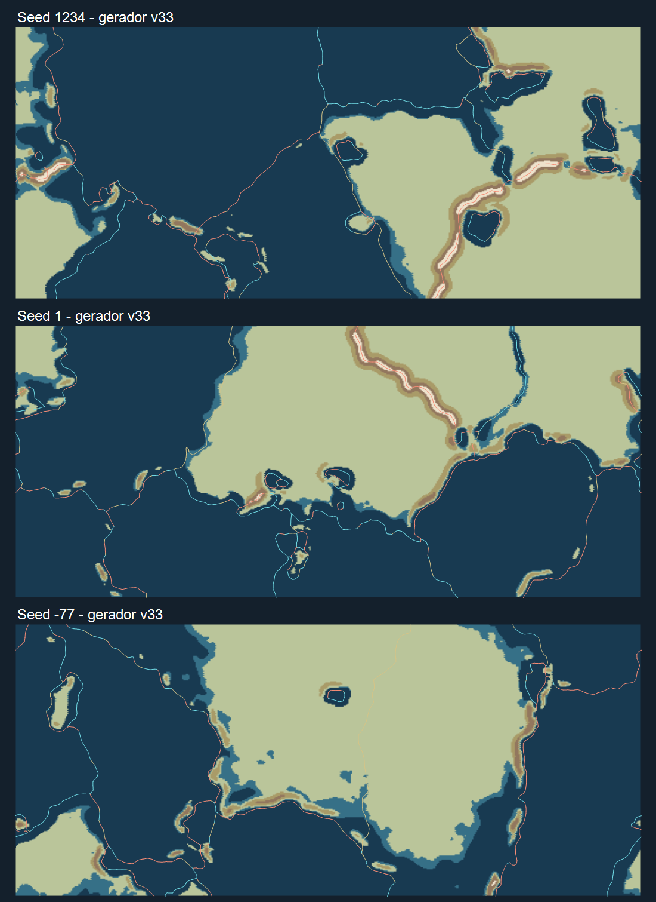

# Tectônica como base da geração — v33

## Problema encontrado

Na v32, a tectônica alterava o campo de terreno, mas várias etapas posteriores descaracterizavam esse efeito:

- O crescimento dos continentes impunha territórios separados e distribuía a terra entre eles.
- As ilhas recebiam aproximadamente 1/60 da terra e candidatos por ruído, apenas favorecidos pela proximidade de arcos tectônicos.
- A elevação ainda incluía serras por ruído independente das colisões.
- A suavização costeira podia apagar cordilheiras de subducção, especialmente em mapas grandes.
- A distribuição quase uniforme das placas maiores limitava a variedade entre seeds.
- A orientação pelo vetor entre centros era inadequada em partes dos limites de microplacas ponderadas.

## Mudança

A partir da v33, a escultura continental segue um caminho próprio baseado nas placas:

1. A crosta continental/oceânica usa o mesmo campo de propriedade e a mesma deformação das fronteiras tectônicas.
2. Colisões continentais elevam o terreno e definem as cristas das cordilheiras.
3. Colisões envolvendo crosta oceânica constroem arcos no lado superior e uma faixa rebaixada no outro lado. Um sinal espacial pela seed separa as partes emersas do arco em ilhas.
4. Afastamentos rebaixam o terreno e suprimem cristas na faixa ativa; o núcleo em terra fica abaixo da categoria montanhas.
5. O nível do mar é escolhido globalmente para conservar a área de terra solicitada. As cotas por continente, a compactação territorial e o orçamento de ilhas aleatórias deixam de atuar nesse caminho.
6. O ruído detalha plataformas e costas sobre a crosta, e a elevação de fundo produz planícies e colinas. Montanhas altas dependem das faixas tectônicas.
7. A suavização preserva a elevação nas faixas costeiras tectonicamente ativas.

A hierarquia, o tamanho e a disposição das placas grandes variam mais pela seed. O controle de continentes orienta a quantidade de placas continentais principais, cujas terras podem se unir ou se dividir. Mundos anteriores preservam suas versões de geração.

## Testes causais

Os pares mantêm a crosta, a seed e o percentual de terra, alterando a força de contato:

| Caso | Resultado |
| --- | --- |
| Adicionar choque oceânico | 370 hexes adicionais na faixa do arco; três ilhas separadas do continente, somando 392 hexes |
| Choque continental | Elevação média de 3.902 m no núcleo amostrado |
| Trocar choque por afastamento | Elevação média de -3.350 m no mesmo núcleo; nenhuma montanha em terra nessa faixa |
| Suavização de uma cordilheira costeira | Altitude preservada em 2.762 m, em vez dos 431 m da suavização anterior |



## Variedade e regressão

Em 512 × 256 com wrap e 38% de terra, as seeds 1234, 1 e -77 mantiveram exatamente 49.807 hexes de terra. As diferenças de terra/mar entre pares sucessivos foram 47,0% e 23,9%. Nenhuma montanha foi encontrada nos núcleos de afastamento ou longe dos campos tectônicos ativos nas três amostras.



Também passaram os testes de determinismo, salvar/abrir, regeneração regional e locks; as configurações de 1 e 12 placas continentais, 10% e 65% de terra, dimensões ímpares e consistência entre geração de terra e terreno completo; e a validação das referências até 4096 × 2048.

Comandos de reprodução:

```text
dotnet build Mapmaker.csproj --no-restore
dotnet run --project tests/GeneratorChecks/GeneratorChecks.csproj -- --plate-review
dotnet run --project tests/GeneratorChecks/GeneratorChecks.csproj -- --large
Godot_v4.7.2-stable_mono_win64_console.exe --headless --path . -- --smoke-test
Godot_v4.7.2-stable_mono_win64_console.exe --headless --path . -- --smoke-test --current-generator-only
Godot_v4.7.2-stable_mono_win64_console.exe --headless --path . -- --maximum-generation
```

A geração continua sendo uma construção procedural de uma superfície geológica, sem evolução temporal das placas. O nível do mar, a crosta e a intensidade do contato determinam se uma elevação oceânica fica submersa ou aparece como ilha; não há obrigação de terra em cada segmento de colisão.

Build sem erros ou avisos; teste geral e teste direcionado à versão atual passaram. O mapa máximo (4096 × 2048) passou em 41,33 s, com 3.187.671 hexes de terra, 36.877 hexes classificados como montanhas/picos, 4.442 hexes alpinos e nenhum término fluvial sem destino.
